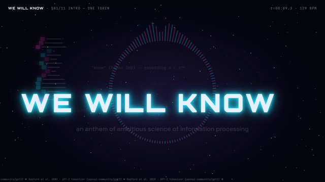
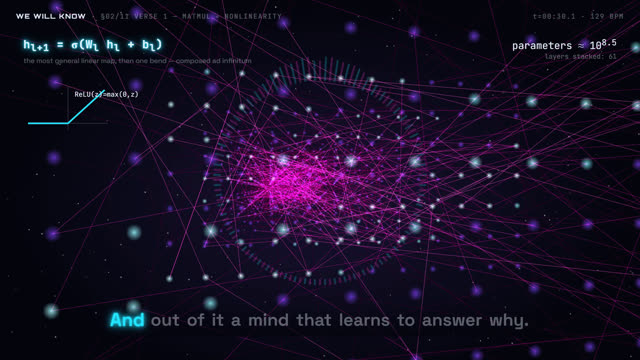
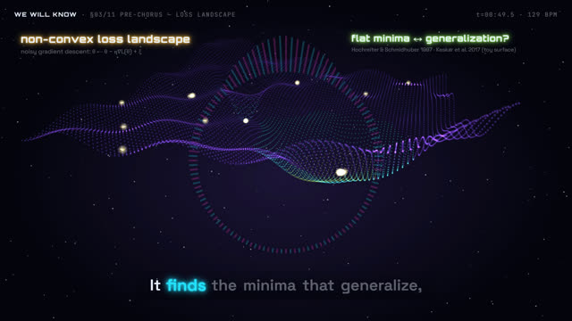
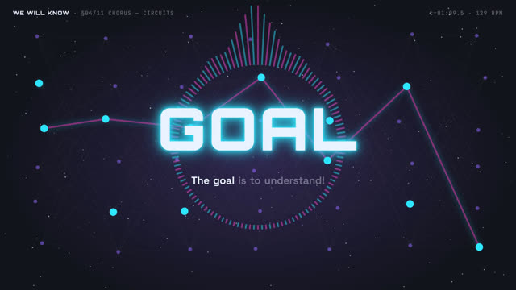
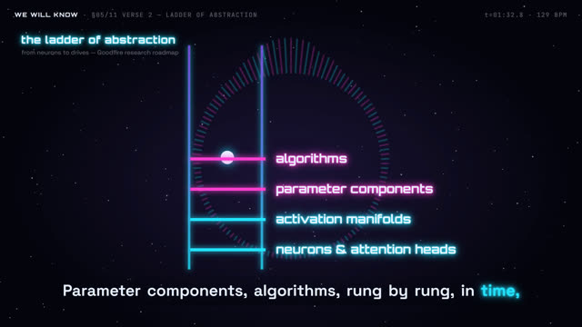
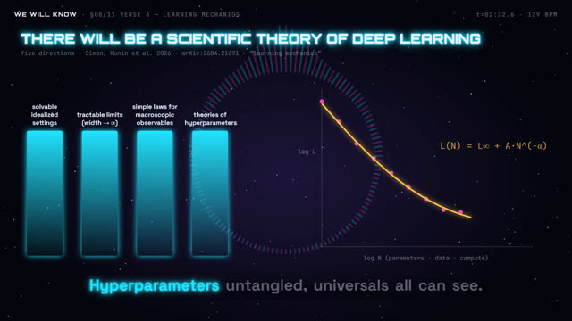
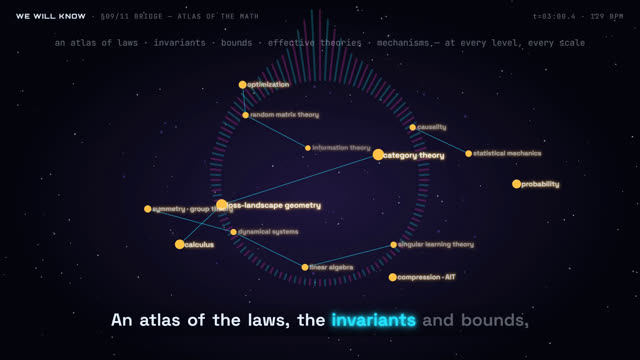
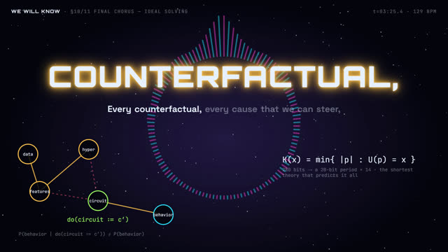
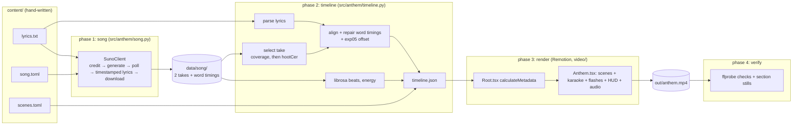

# We Will Know: an anthem of ambitious science of information processing

An original song plus a music video in which **every frame is drawn in code**. The song is an epic cinematic anthem about ambitious interpretability and a science of deep learning: *"We will know. We will understand. The goal is to understand."*
- **Music:** generated by Suno V6 through the [sunoapi.org](https://docs.sunoapi.org/) API.
- **Lyrics, pipeline and visuals:** written by Claude in this repository, with the visuals in Remotion + Three.js.
- **Sync:** lyrics are highlighted word by word from Suno's word timings, and scene cuts land on beats tracked with librosa.
- **Timing correction:** a pre-registered experiment found that Suno's word onsets are 0.137 s late on the take used. Every word is shifted by −0.137 s; see [experiment 5](reports/exp05_onset_offset.md).

**Video:** [we-will-know-anthem.mp4](https://github.com/BurnyCoder/ambitious-science-of-information-processing-anthem/releases/download/v1.1.0/we-will-know-anthem.mp4) (1920×1080, 30 fps, 4:00, 218 MB) from [release v1.1.0](https://github.com/BurnyCoder/ambitious-science-of-information-processing-anthem/releases/tag/v1.1.0), with karaoke onsets corrected by [experiment 5](reports/exp05_onset_offset.md). The uncorrected first cut is in [release v1.0.0](https://github.com/BurnyCoder/ambitious-science-of-information-processing-anthem/releases/tag/v1.0.0). **Paper:** [reports/paper.pdf](reports/paper.pdf).

| Intro | Verse 1: layers | Pre-chorus: loss landscape | Chorus: circuits |
|---|---|---|---|
|  |  |  |  |
| **Verse 2: ladder of abstraction** | **Verse 3: theory of deep learning** | **Bridge: atlas of the math** | **Final chorus: ideal solving** |
|  |  |  |  |

## Methodology (how the song and the video are made)

1. **Lyrics and style.** The lyrics are written by hand in `content/lyrics.txt`, in Suno's tagged format: `[Verse 1]`, `[Chorus]`, `(backing vocals)`. `content/song.toml` holds the title, the style ("epic cinematic anthem, hybrid orchestral, massive choir, … 124 BPM …"), negative tags and vocal gender. They distil the project brief:
   - full understanding of AI;
   - Goodfire's *ladder of abstraction* and *encyclopedia of explanations*;
   - the five directions of [*There Will Be a Scientific Theory of Deep Learning*](https://arxiv.org/abs/2604.21691);
   - an atlas of the mathematics of information processing;
   - "ideal solving": the shortest theory that predicts everything, plus counterfactual causality.
2. **Song generation (paid, once).** One custom-mode V6 generation (`duration: 240`) returns **two takes**. Each take's MP3, its cover and Suno's per-word timings (`get-timestamped-lyrics`) are downloaded and cached in `data/song/`. Later runs reuse the cache.
3. **Take selection (rule fixed before generation).** The chosen take has the highest alignment coverage (share of written words matched to a Suno word with `success=true`), with ties broken by the lower `hootCer`. Both takes reached coverage 1.0, so the tie-break picked **take 1** (hootCer 0.155 vs 0.165).
4. **Word alignment.** Suno's aligned tokens are cleaned (tags and line breaks are glued onto words) and sequence-aligned to the written words with `difflib`. Missing words are interpolated.
   - A minimal repair step moves only grossly misplaced words: mid-line words longer than 3 s, plus the words left behind before them. It moved 2 of 430 words in take 1.
   - A first, broader repair rule was **falsified** by a pre-registered test against an independent Whisper reference, which showed it made 27 words 0.8–2.5 s late. See [experiment 3](reports/exp03_alignment_repair.md).
   - Raw Suno timings agree with Whisper word onsets to a median of 0.235 s ([experiment 3](reports/exp03_alignment_repair.md)).
   - **Onset correction.** [Experiment 5](reports/exp05_onset_offset.md) separated the vocals with Demucs and force-aligned the known lyrics on the vocal stem with torchaudio's MMS_FA. It also hand-labelled 34 line-start onsets blind.
     - Suno's onsets on take 1 are late by 0.137 s (95 % CI 0.125–0.147 s), constant over the song. Whisper's are early by 0.080 s.
     - The pre-registered rule therefore shifts every word by `VIDEO_WORD_OFFSET_S=-0.137`. This cut the median distance to the hand-labelled onsets from 0.233 s to 0.131 s (post hoc).
     - The value is specific to take 1: take 2 measured 0.061 s.
5. **Audio analysis.** librosa tracks beats on the onset-strength envelope at hop 256, which is validated on synthetic click tracks in [experiment 2](reports/exp02_beat_tracking.md). It also computes downbeats (4/4 heuristic) and per-frame RMS energy and onset strength.
6. **Timeline.** `video/public/timeline.json` contains the sections and their scenes, the lines and words with times, the beats, and the per-frame features. Each section boundary is the section's first sung word minus 0.1 s, snapped to a beat within ±0.3 s.
7. **Rendering.** A Remotion composition stacks the following, all as pure functions of the frame number (deterministic, parallel rendering):
   - a starfield;
   - an audio spectrum ring;
   - one scene per section (2D SVG or Three.js);
   - a karaoke overlay, or giant kinetic words in the choruses;
   - beat and cut flashes;
   - a HUD.
8. **Verification.** ffprobe checks resolution, fps, codecs and duration against the song. ffmpeg extracts one still per section for visual inspection.

## Quickstart

Prerequisites: [uv](https://docs.astral.sh/uv/), Node.js ≥ 18 (tested on 24), ffmpeg/ffprobe on `PATH`, and a [sunoapi.org](https://sunoapi.org) API key. The key is only needed to generate a *new* song; the cached song in `data/song/` is enough to rebuild the video.

```bash
git clone https://github.com/BurnyCoder/ambitious-science-of-information-processing-anthem
cd ambitious-science-of-information-processing-anthem
uv sync                              # Python 3.12 venv in .venv
cd video && npm install && cd ..     # Remotion, Three.js (Chrome Headless Shell downloads on first render)
cp .env.example .env                 # then set SUNO_API_KEY=... (optional if you reuse data/song)
uv run anthem                        # song (cached) -> timeline -> render -> verify  => out/anthem.mp4
```

Useful variants:

```bash
uv run anthem --stage song --regenerate-song   # pay for a new generation (2 takes)
uv run anthem --stage timeline --take f16f     # rebuild timeline from take 2 instead of the rule's choice
uv run anthem --stage render --preview         # 30 s at 960x540 for a quick look
cd video && npm run studio                     # scrub the video interactively in Remotion Studio
cd video && node scripts/stills.mjs 2084 5419  # render specific frames to out/stills/
uv run pytest -q                               # 40 offline tests (no credits spent)
uv run --group analysis python scripts/validate_onset_offset.py  # exp05: Demucs + MMS_FA onset reference (~6 min on CPU)
```

Settings live in `.env`; see `.env.example`. They are `SUNO_API_KEY`, `SUNO_API_BASE_URL`, `SUNO_MODEL` (V6), `SONG_DURATION_S` (240), `SUNO_POLL_INTERVAL_S`, `SUNO_TIMEOUT_S`, `SUNO_CALLBACK_URL`, `VIDEO_FPS` (30), `RENDER_CONCURRENCY` (8) and `VIDEO_WORD_OFFSET_S`. The last is seconds added to every Suno word time; the code default is 0, and `.env.example` sets −0.137, exp05's value for take 1, which the shipped video uses.

## What happens when you run it



Data flow during `uv run anthem`. Everything is logged with timestamps to the terminal and to `logs/run_<timestamp>.log`, including full untruncated Suno request and response JSON and 5% render-progress steps.

1. **song**
   - If `data/song/song.json` exists, it is reused at no cost.
   - Otherwise the phase logs the credit balance, submits the lyrics, and polls every 15 s (`PENDING → TEXT_SUCCESS → SUCCESS`, about 1 minute).
   - It then downloads both MP3s and covers and stores each take's word timings.
2. **timeline**
   - Parses the lyrics into 11 sections and 58 lines, scores both takes, picks one, and aligns its 430 words.
   - Shifts every word by `VIDEO_WORD_OFFSET_S` (−0.137 s in `.env.example`).
   - Analyzes the audio (about 10 s) and writes `video/public/timeline.json` plus a copy of the MP3.
3. **render**
   - `npx remotion render … --gl=angle` bundles the project, runs `calculateMetadata` (video length = song length, 7213 frames), and renders the frames in 8 parallel headless-Chrome tabs.
   - It then encodes H.264 + AAC to `out/anthem.mp4`. This took about 6 minutes on a 16-thread desktop.
4. **verify**
   - Checks 1920×1080, 30 fps, h264/aac, and duration within 0.5 s of the song.
   - Writes `out/anthem_verify.json` and `out/stills/verify_s*.png`.
   - Exits non-zero on failure.

## Features

- **One command** (`uv run anthem`) runs the whole song-to-video pipeline. Stages can be re-run individually with `--stage`.
- **Paid generation happens at most once.** Results are cached, and tests never touch the network.
- **Word-level karaoke sync** from Suno's timestamped lyrics, with alignment, artifact repair, and an onset correction measured against a forced-aligned vocal stem.
- **Beat-synced cuts and flashes** from librosa beat tracking, validated on ground-truth click tracks.
- **Ten code-drawn scenes**, each tied to the lyric it illustrates; keyword reveals fire when the word is sung. See [docs/scenes.md](docs/scenes.md).
- **Deterministic rendering**: Remotion, with every frame a pure function of the frame number.
- **Automated verification** of the output file, plus stills for visual review.
- **Pre-specified, documented experiments** in [reports/](reports/), with a [technical report PDF](reports/paper.pdf).

## Technologies

| Purpose | Technology |
|---|---|
| Music generation | Suno V6 via [sunoapi.org](https://docs.sunoapi.org/) (third party; Suno has no official public API) |
| Pipeline | Python 3.12, [uv](https://docs.astral.sh/uv/), [httpx](https://www.python-httpx.org/), [python-dotenv](https://github.com/theskumar/python-dotenv) |
| Audio analysis | [librosa](https://librosa.org/) 1.0 (beat tracking, onset strength, RMS), [soundfile](https://python-soundfile.readthedocs.io/) |
| Video | [Remotion](https://www.remotion.dev/) 4.0.536 (React 19, TypeScript), [Three.js](https://threejs.org/) 0.186 via [@remotion/three](https://www.remotion.dev/docs/three) / React Three Fiber 9, `@remotion/media-utils` (spectrum), `@remotion/google-fonts` (Orbitron, Space Grotesk, JetBrains Mono) |
| Verification | ffmpeg / ffprobe |
| Experiments | scipy (CIs, Wilcoxon, bootstrap), [faster-whisper](https://github.com/SYSTRAN/faster-whisper) (independent word-timing reference), [Demucs](https://github.com/facebookresearch/demucs) `htdemucs` (vocal separation), [torchaudio](https://docs.pytorch.org/audio/) `MMS_FA` + PyTorch (CTC forced alignment), matplotlib (figures); installed with `uv sync --group analysis` |
| Tests | pytest with `httpx.MockTransport` |

## Repository layout

```
content/            lyrics.txt, song.toml (Suno spec), scenes.toml (section -> scene)
src/anthem/         pipeline.py (wrapper) + config, logging_setup, suno_client, song, lyrics,
                    alignment, take_selection, audio_analysis, timeline, render, verify
video/              Remotion project: src/Root.tsx, src/Anthem.tsx, src/lib, src/components, src/scenes, scripts/stills.mjs
data/song/          generated takes, covers, raw Suno timing JSON, song.json (cache)
tests/              pytest suite (offline)
scripts/            experiment scripts (exp02, exp03, exp05, figures) + analysis/ (shared helpers: stats,
                    Whisper reference, Demucs separation, MMS_FA alignment, blinded anchors, decision rule)
docs/               architecture, Suno API notes, scene guide, images
reports/            per-experiment reports, summary, technical report (paper.md / paper.pdf)
```

More detail: [docs/architecture.md](docs/architecture.md) (modules and the `timeline.json` contract), [docs/suno-api.md](docs/suno-api.md) (endpoints and observed quirks), [docs/scenes.md](docs/scenes.md) (what each scene shows and its sources), [AGENTS.md](AGENTS.md) (rules for agents and contributors), [reports/experiments.md](reports/experiments.md) (results).

## Notes and licenses

- **Remotion** is free for individuals and small companies; see the [Remotion license](https://www.remotion.dev/docs/license).
- **The generated song** is subject to Suno's and sunoapi.org's terms for the plan used.
- **Video credits:** concept by Libor Burian; lyrics, code and every frame by Claude; song by Suno V6.
