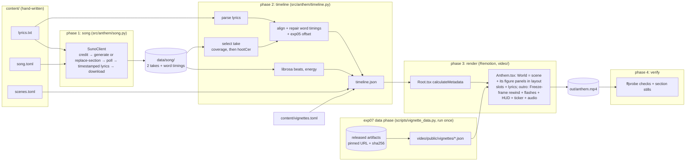

# We Will Know: an anthem of ambitious science of information processing

An original song plus a music video in which **every frame is drawn in code**. The song is an epic cinematic anthem about ambitious interpretability and a science of deep learning: *"We will know. We will understand. The goal is to understand."*
- **Music:** generated by Suno V6 through the [sunoapi.org](https://docs.sunoapi.org/) API.
- **Lyrics, pipeline and visuals:** written by Claude in this repository, with the visuals in Remotion + Three.js.
- **Sync:** lyrics are highlighted word by word from Suno's word timings, and scene cuts land on beats tracked with librosa.
- **Timing correction:** a pre-registered experiment found that Suno's word onsets are late. The lag was 0.137 s on the original take and is 0.156 s on the edited take the video uses, so every word is shifted by −0.156 s. See [experiment 5](reports/exp05_onset_offset.md) and [experiment 6](reports/exp06_lyric_edit.md).
- **Illustration track (v1.3.0):** 86 figure cards, at least one per sung line. Each card appears as its word is sung and carries a provenance badge and a citation.
  - The concrete content comes from data released with the papers, and **no experiment was re-run**. Examples:
    - Anthropic's Dallas → Austin, rabbit-rhyme and 36+59 attribution graphs, which also drive the chorus circuits;
    - Nanda et al.'s grokking run and its Fourier key frequencies;
    - ARENA's induction-head scores, Neuronpedia features, Arditi et al.'s refusal scores;
    - Epoch AI's model and Chinchilla data, Nakkiran et al.'s double descent;
    - Gurnee & Tegmark's places, Goodfire's block-sparse-featurizer figure.
  - See [docs/vignettes.md](docs/vignettes.md) and [experiment 7](reports/exp07_provenance.md).
- **Figures as part of the scenes (v1.5.0):** each scene owns its figures.
  - **Panels.** At most two per scene, in slots its layout reserves away from its key objects. Each stays for its whole time (≥ 3 s) and is wired to the rung, star, basin or node it explains.
  - **Drawn in place.** Ideas the scene can show itself are drawn inside it: an atlas star's label grows into its formula, and the theory blocks open to their plots as each direction is sung.
  - **The general pictures stay.** Nothing dims or covers the layer tunnel, the gradient-descent landscape, the circuit network, the ladder, the point clouds, the blocks or the atlas.
  - **The rewind.** The outro is a flying, accelerating rewind through the whole video, landing on the opening token.
  
  See [docs/scenes.md](docs/scenes.md) and [experiment 9](reports/exp09_unified.md).
- **One-line lyric edit:** the word "mind" was taken out of Verse 1 ("And out of it a **thing** that learns to answer why"). Only that part was re-sung, with Suno's replace-section. The line was fixed, but Suno regenerated about 30 s of audio rather than the requested 11.6 s window, and it shifted the file by 17 ms. See [experiment 6](reports/exp06_lyric_edit.md).

**Video:** [we-will-know-anthem.mp4](https://github.com/BurnyCoder/ambitious-science-of-information-processing-anthem/releases/download/v1.5.0/we-will-know-anthem.mp4) (1920×1080, 30 fps, 4:00) from [release v1.5.0](https://github.com/BurnyCoder/ambitious-science-of-information-processing-anthem/releases/tag/v1.5.0): figures as part of their scenes, and the rewind finale. Older cuts:
- [v1.4.0](https://github.com/BurnyCoder/ambitious-science-of-information-processing-anthem/releases/tag/v1.4.0): figure cards as centre hero shots over a dimmed scene.
- [v1.3.0](https://github.com/BurnyCoder/ambitious-science-of-information-processing-anthem/releases/tag/v1.3.0): the same 86 cards in corner boxes beside the scenes.
- [v1.2.0](https://github.com/BurnyCoder/ambitious-science-of-information-processing-anthem/releases/tag/v1.2.0): the edited lyric with corrected onsets, no figure cards.
- [v1.1.0](https://github.com/BurnyCoder/ambitious-science-of-information-processing-anthem/releases/tag/v1.1.0): the original lyric, corrected onsets.
- [v1.0.0](https://github.com/BurnyCoder/ambitious-science-of-information-processing-anthem/releases/tag/v1.0.0): uncorrected.

**Paper:** [reports/paper.pdf](reports/paper.pdf).

| Intro | Verse 1: layers | Pre-chorus: loss landscape | Chorus: circuits |
|---|---|---|---|
|  |  |  |  |
| **Verse 2: ladder of abstraction** | **Verse 3: theory of deep learning** | **Bridge: atlas of the math** | **Final chorus: ideal solving** |
|  |  |  |  |

Figures inside the general scenes (frames of the v1.5.0 video):


Twelve figure cards, all drawn from released data (shown as in v1.3.0):


**Highlights of v1.5.0** ([experiment 9](reports/exp09_unified.md)):
- **Figures stay long enough to read.** The median time on screen is 6.0 s (v1.4.0: 2.2 s as the hero). 1 of 82 figures is shown under 2 s, against 41 of 86 before.
- **No figure covers a scene's key object.** v1.4.0's hero covered one the whole time it was up. In v1.5.0 a panel never covers one: every slot is checked against each scene's protected regions.
- **Detail kept.** Before the outro, frames are not less detailed than v1.4.0: median log₂ PNG-size ratio +0.033, 95 % CI [−0.047, +0.102]. Verse 1 +0.21, the landscape +0.10.
- **Negative findings.**
  - The pre-registered check of the 0:14 window failed on the first render: it was fuller than v1.4.0 but about 0.58 log₂ below v1.3.0. After a post-hoc fix (verse 1's layers fly out behind the tokens card), the final video is at −0.09, much fuller than v1.4.0 but still short of the criterion.
  - The bridge lost detail (−0.22): its 21 formula cards became star labels that grow two at a time.
  - No viewer study was run.

**Highlights of v1.4.0** ([experiment 8](reports/exp08_integration.md)):
- **Inside the scenes.**
  - 71 of the 86 cards dock into a scene object; the other 15 fly past the camera in the three fly-through scenes.
  - A hero covers at most 33 % of the frame, for at most 3.2 s.
  - The camera push is at most 8 %, so the general scene stays visible around every example.
- **Real numbers in the general pictures.** Examples: the loss surface's own saddle (Hessian eigenvalues −0.27, +0.19, found by Newton's method), the sharp vs flat basin curvature (1.76 vs 0.27), and the traced prompt under the chorus circuits.
- **Detail kept, not gained.** The pre-registered test passes: frames are not less detailed than v1.3.0 by more than the margin. The median log₂ PNG-size ratio is −0.014, with 95 % CI [−0.075, +0.016].
- **Negative findings.**
  - Verse 1 lost detail (−0.19), as did the bridge (−0.11); the finale gained (+0.13). Dimming the scene behind the hero may explain part of the loss, but this was not tested.
  - A figure is centre stage 83 % of the sung time. The general scene has the frame alone for a quarter of the song.
  - No viewer study was run.

**Highlights of v1.3.0** ([experiment 7](reports/exp07_provenance.md)):
- **Consistent with the papers.**
  - The five largest Fourier frequencies of the released grokking embedding are exactly the paper's key frequencies {14, 35, 41, 42, 52}.
  - ARENA's top induction heads include the IOI paper's 5.5 and 6.9.
- **Coverage and density.** Every sung line has a card (56/56). Frames are more detailed than v1.2.0 at the same moments: median PNG size ×1.20 (log₂ +0.263, 95 % CI [+0.177, +0.422]).
- **Negative findings.**
  - The fact-check found three overclaims in our own plan (a Golden Gate quote, an ActAdd layer, a WeightWatcher "well trained" band), which were removed before release.
  - Verse 1 gained no measurable detail (+0.003).
  - Denser is not shown to be better: no viewer study was run.

## Methodology (how the song and the video are made)

1. **Lyrics and style.** The lyrics are written by hand in `content/lyrics.txt`, in Suno's tagged format: `[Verse 1]`, `[Chorus]`, `(backing vocals)`. `content/song.toml` holds the title, the style ("epic cinematic anthem, hybrid orchestral, massive choir, … 124 BPM …"), negative tags and vocal gender. They distil the project brief:
   - full understanding of AI;
   - Goodfire's *ladder of abstraction* and *encyclopedia of explanations*;
   - the five directions of [*There Will Be a Scientific Theory of Deep Learning*](https://arxiv.org/abs/2604.21691);
   - an atlas of the mathematics of information processing;
   - "ideal solving": the shortest theory that predicts everything, plus counterfactual causality.
2. **Song generation (paid, once).** One custom-mode V6 generation (`duration: 240`) returns **two takes**. Each take's MP3, its cover and Suno's per-word timings (`get-timestamped-lyrics`) are downloaded and cached in `data/song/`. Later runs reuse the cache.
   - **Lyric edits (paid, on request).** `--replace-lines FIRST LAST` re-sings those lines of the cached take with the current `lyrics.txt` through Suno's [replace-section](https://docs.sunoapi.org/suno-api/replace-section). The window runs from gap midpoint to gap midpoint around the lines and must be at least 10 s.
   - Only takes of the original length are cached, and `song.json` records the parent take under `parent`.
   - `banned_words` in `song.toml` (currently "mind") makes the pipeline refuse lyrics before any paid call.
3. **Take selection (rule fixed before generation).** The chosen take has the highest alignment coverage (share of written words matched to a Suno word with `success=true`), with ties broken by the lower `hootCer`.
   - Both takes reached coverage 1.0, so the tie-break picked **take 1** (hootCer 0.155 vs 0.165).
   - The lyric edit re-sang take 1. Its one full-length result, `303ab1c3` (coverage 1.0, hootCer 0.148), is the take the video uses now.
4. **Word alignment.** Suno's aligned tokens are cleaned (tags and line breaks are glued onto words) and sequence-aligned to the written words with `difflib`. Missing words are interpolated.
   - A minimal repair step moves only grossly misplaced words: mid-line words longer than 3 s, plus the words left behind before them. It moved 2 of 430 words in take 1.
   - A first, broader repair rule was **falsified** by a pre-registered test against an independent Whisper reference, which showed it made 27 words 0.8–2.5 s late. See [experiment 3](reports/exp03_alignment_repair.md).
   - Raw Suno timings agree with Whisper word onsets to a median of 0.235 s ([experiment 3](reports/exp03_alignment_repair.md)).
   - **Onset correction.** [Experiment 5](reports/exp05_onset_offset.md) separated the vocals with Demucs and force-aligned the known lyrics on the vocal stem with torchaudio's MMS_FA. It also hand-labelled 34 line-start onsets blind.
     - Suno's onsets on take 1 are late by 0.137 s (95 % CI 0.125–0.147 s), constant over the song. Whisper's are early by 0.080 s.
     - The pre-registered rule therefore shifts every word by `VIDEO_WORD_OFFSET_S=-0.137`. This cut the median distance to the hand-labelled onsets from 0.233 s to 0.131 s (post hoc).
     - The value is take-specific: take 2 measured 0.061 s.
     - **After the lyric edit** ([experiment 6](reports/exp06_lyric_edit.md)), Suno returned word times copied from the parent take, but the audio played 17 ms earlier. exp05's rule, re-run on the edited take, gives δ = 0.156 s (95 % CI 0.144–0.167 s), so the video uses `VIDEO_WORD_OFFSET_S=-0.156`.
5. **Audio analysis.** librosa tracks beats on the onset-strength envelope at hop 256, which is validated on synthetic click tracks in [experiment 2](reports/exp02_beat_tracking.md). It also computes downbeats (4/4 heuristic) and per-frame RMS energy and onset strength.
6. **Timeline.** `video/public/timeline.json` contains the sections and their scenes, the lines and words with times, the beats, and the per-frame features. Each section boundary is the section's first sung word minus 0.1 s, snapped to a beat within ±0.3 s.
7. **Illustration track.** `content/vignettes.toml` declares 82 figure cards, at least one per sung line. Each card is placed 0.15 s before the sung word it illustrates, either as a panel in one of its scene's two layout slots or drawn by the scene itself, carries a provenance badge (released data, published numbers, live math, from the paper, schematic) and a citation. Catalog: [docs/vignettes.md](docs/vignettes.md).
   - **No experiment is re-run.** `scripts/vignette_data.py` downloads pinned files released by the original authors or well-known third parties, including:
     - Nanda et al.'s grokking run, Anthropic's attribution graphs and toy-model notebook;
     - ARENA's induction scores, Neuronpedia features, Epoch AI's model and Chinchilla data;
     - Nakkiran et al.'s double-descent runs, Gurnee & Tegmark's places, Todd et al.'s antonyms;
     - Arditi et al.'s refusal scores, WeightWatcher, Goodfire's BSF figure, and the GPT-2 tokenizer.
   - It derives small card files from them and records URL, revision, licence and sha256 ([experiment 7](reports/exp07_provenance.md)).
8. **Rendering.** A Remotion composition stacks the following, all as pure functions of the frame number (deterministic, parallel rendering):
   - a starfield and faint drifting "equation dust" (the section's card titles);
   - an audio spectrum ring;
   - one scene per section (2D SVG or Three.js), punch-zoomed on downbeats and RGB-split for 0.25 s after each cut. Each scene draws its general picture with concrete examples inside it;
   - the figure panels, in the two slots the scene's layout reserves away from its key objects (`video/src/stage/layout.json`):
     - a panel emerges from the object it explains and stays, wired to it, for its whole time;
     - it docks back into the object at its end ([experiment 9](reports/exp09_unified.md));
     - other figures are drawn by the scene itself;
   - a karaoke overlay, or giant kinetic words in the lower third of the choruses;
   - beat and cut flashes, a HUD and a scrolling citation ticker;
   - in the outro, the rewind: Remotion `<Freeze>` copies of earlier frames, beat-cut backwards ever faster, landing on the opening token.
9. **Verification.** ffprobe checks resolution, fps, codecs and duration against the song. ffmpeg extracts one still per section for visual inspection.

## Quickstart

Prerequisites: [uv](https://docs.astral.sh/uv/), Node.js ≥ 18 (tested on 24), ffmpeg/ffprobe on `PATH`, and a [sunoapi.org](https://sunoapi.org) API key. The key is only needed to generate a *new* song; the cached song in `data/song/` is enough to rebuild the video.

```bash
git clone https://github.com/BurnyCoder/ambitious-science-of-information-processing-anthem
cd ambitious-science-of-information-processing-anthem
uv sync                              # Python 3.12 venv in .venv
cd video && npm install && cd ..     # Remotion, Three.js (Chrome Headless Shell downloads on first render)
cp .env.example .env                 # then set SUNO_API_KEY=... (optional if you reuse data/song)
uv run anthem                        # song (cached) -> timeline -> render -> verify  => out/anthem.mp4
```

Useful variants:

```bash
uv run anthem --stage song --regenerate-song   # pay for a new generation (2 takes)
uv run anthem --stage song --replace-lines 4 6 # pay to re-sing lyric lines 4-6 of the cached take (exp06)
uv run anthem --stage timeline --take f16f     # rebuild timeline from take 2 instead of the rule's choice
uv run anthem --stage render --preview         # 30 s at 960x540 for a quick look
cd video && npm run studio                     # scrub the video interactively in Remotion Studio
cd video && node scripts/stills.mjs 2084 5419  # render specific frames to out/stills/
uv run pytest -q                               # 61 offline tests (no credits spent)
uv run --group analysis python -I scripts/vignette_data.py  # exp07: fetch released artifacts -> card data (~524 MB, once)
cd video && node scripts/stills.mjs --vignettes # one still per figure card
uv run --group analysis python scripts/validate_onset_offset.py  # exp05: Demucs + MMS_FA onset reference (~6 min on CPU)
uv run --group analysis python scripts/validate_lyric_edit.py    # exp06: checks of the lyric edit + offset re-estimate
```

Settings live in `.env`; see `.env.example`. They are `SUNO_API_KEY`, `SUNO_API_BASE_URL`, `SUNO_MODEL` (V6), `SONG_DURATION_S` (240), `SUNO_POLL_INTERVAL_S`, `SUNO_TIMEOUT_S`, `SUNO_CALLBACK_URL`, `VIDEO_FPS` (30), `RENDER_CONCURRENCY` (8) and `VIDEO_WORD_OFFSET_S`. The last is seconds added to every Suno word time. The code default is 0. `.env.example` sets −0.156, the value exp06 measured for the edited take, which the shipped video uses.

## What happens when you run it



Data flow during `uv run anthem`. Everything is logged with timestamps to the terminal and to `logs/run_<timestamp>.log`, including full untruncated Suno request and response JSON and 5% render-progress steps.

1. **song**
   - If `data/song/song.json` exists, it is reused at no cost.
   - Otherwise the phase logs the credit balance, submits the lyrics, and polls every 15 s (`PENDING → TEXT_SUCCESS → SUCCESS`, about 1 minute).
   - It then downloads both MP3s and covers and stores each take's word timings.
   - With `--replace-lines`, it submits a replace-section task for the cached take instead, and caches only the full-length results.
2. **timeline**
   - Parses the lyrics into 11 sections and 58 lines, scores the cached takes, picks one, and aligns its 430 words.
   - Shifts every word by `VIDEO_WORD_OFFSET_S` (−0.156 s in `.env.example`).
   - Analyzes the audio (about 10 s), places the 82 figure cards at their sung words (logging trims and coverage), and writes `video/public/timeline.json` plus a copy of the MP3.
3. **render**
   - `npx remotion render … --gl=angle` bundles the project, runs `calculateMetadata` (video length = song length, 7212 frames), and renders the frames in 8 parallel headless-Chrome tabs.
   - It then encodes H.264 + AAC to `out/anthem.mp4`. This took about 11 minutes for v1.5.0 (7.5 for v1.3.0) on a 16-thread desktop.
4. **verify**
   - Checks 1920×1080, 30 fps, h264/aac, and duration within 0.5 s of the song.
   - Writes `out/anthem_verify.json` and `out/stills/verify_s*.png`.
   - Exits non-zero on failure.

## Features

- **One command** (`uv run anthem`) runs the whole song-to-video pipeline. Stages can be re-run individually with `--stage`.
- **Paid calls happen only on request:** one generation, plus one lyric-line edit so far. Results are cached, banned lyric words are refused before any call, and tests never touch the network.
- **Word-level karaoke sync** from Suno's timestamped lyrics, with alignment, artifact repair, and an onset correction measured against a forced-aligned vocal stem.
- **Beat-synced cuts and flashes** from librosa beat tracking, validated on ground-truth click tracks.
- **Ten code-drawn scenes**, each tied to the lyric it illustrates; keyword reveals fire when the word is sung. Each keeps its general picture and draws concrete examples inside it. Examples:
  - the sung line's real GPT-2 token ids in the layer tunnel;
  - the loss surface's own saddle with its Hessian eigenvalues, and released grokking and double-descent curves over the surface;
  - the traced prompt under the chorus circuits ("… Dallas is → Austin");
  - an encyclopedia that files the ladder's figures;
  - the 280-bit string collapsing into its program.
  
  See [docs/scenes.md](docs/scenes.md).
- **Figures as part of their scenes (v1.5.0):** at most two panels per scene, in slots reserved away from its key objects, each wired to the rung, star, basin or node it explains. Some figures are drawn by the scene itself: atlas star labels grow into formulas, and the theory blocks open to their plots.
- **A flying rewind finale:** the outro beat-cuts backwards through every section and figure, faster and faster, and lands on the opening token.
- **82 figure cards**, at least one per sung line, each with a provenance badge and a citation. Released data is reused, never re-generated. Concrete examples include:
  - Anthropic's Dallas → Austin, rabbit-rhyme and 36+59 attribution graphs, and the grokking run with its Fourier key frequencies;
  - GPT-2's induction heads, the IOI circuit and the refusal direction;
  - Chinchilla's 245 runs with two published fits, double descent, and Goodfire's block-sparse featurizer figure;
  - superposition, the Pioneer plaque's hydrogen line, and more. See [docs/vignettes.md](docs/vignettes.md).
- **Maximalist motion**: downbeat punch zoom, RGB-split cut glitch, drifting equation dust, and a citation ticker naming every source on screen.
- **Deterministic rendering**: Remotion, with every frame a pure function of the frame number.
- **Automated verification** of the output file, plus stills for visual review.
- **Pre-specified, documented experiments** in [reports/](reports/), with a [technical report PDF](reports/paper.pdf).

## Technologies

| Purpose | Technology |
|---|---|
| Music generation | Suno V6 via [sunoapi.org](https://docs.sunoapi.org/) (third party; Suno has no official public API) |
| Pipeline | Python 3.12, [uv](https://docs.astral.sh/uv/), [httpx](https://www.python-httpx.org/), [python-dotenv](https://github.com/theskumar/python-dotenv) |
| Audio analysis | [librosa](https://librosa.org/) 1.0 (beat tracking, onset strength, RMS), [soundfile](https://python-soundfile.readthedocs.io/) |
| Video | [Remotion](https://www.remotion.dev/) 4.0.536 (React 19, TypeScript), [Three.js](https://threejs.org/) 0.186 via [@remotion/three](https://www.remotion.dev/docs/three) / React Three Fiber 9, `@remotion/media-utils` (spectrum), `@remotion/paths` (`evolvePath` line drawing), `@remotion/noise` (equation dust), `@remotion/google-fonts` (Orbitron, Space Grotesk, JetBrains Mono) |
| Verification | ffmpeg / ffprobe |
| Released data for the cards | [huggingface_hub](https://huggingface.co/docs/huggingface_hub) (pinned revisions), [tokenizers](https://github.com/huggingface/tokenizers) (GPT-2 BPE), Pillow; sources and licences in [reports/data/exp07_sources.json](reports/data/exp07_sources.json) |
| Experiments | scipy (CIs, Wilcoxon, bootstrap), [faster-whisper](https://github.com/SYSTRAN/faster-whisper) (independent word-timing reference), [Demucs](https://github.com/facebookresearch/demucs) `htdemucs` (vocal separation), [torchaudio](https://docs.pytorch.org/audio/) `MMS_FA` + PyTorch (CTC forced alignment), matplotlib (figures); installed with `uv sync --group analysis` |
| Tests | pytest with `httpx.MockTransport`; `node --test` for the video's math (`video/tests/`) |

## Repository layout

```
content/            lyrics.txt, song.toml (Suno spec), scenes.toml (section -> scene), vignettes.toml (figure cards)
src/anthem/         pipeline.py (wrapper) + config, logging_setup, suno_client, song, lyrics,
                    alignment, take_selection, audio_analysis, timeline, vignettes, render, verify
video/              Remotion project: src/Root.tsx, src/Anthem.tsx, src/lib (incl. mathviz.ts), src/components,
                    src/scenes, src/stage (hero-shot lifecycle + anchors), src/vignettes (card bodies),
                    public/vignettes (card data), scripts/stills.mjs, tests/
data/song/          generated takes, covers, raw Suno timing JSON, song.json (cache)
tests/              pytest suite (offline)
scripts/            experiment scripts (exp02, exp03, exp05, exp06, exp07 data + density, exp08 integration, figures, card docs) + analysis/ (shared helpers: stats,
                    released-artifact helpers, Whisper reference, Demucs separation, MMS_FA alignment, blinded anchors, decision rule, shot-lifecycle mirror)
docs/               architecture, Suno API notes, scene guide, images
reports/            per-experiment reports, summary, technical report (paper.md / paper.pdf)
```

More detail: [docs/architecture.md](docs/architecture.md) (modules and the `timeline.json` contract), [docs/suno-api.md](docs/suno-api.md) (endpoints and observed quirks), [docs/scenes.md](docs/scenes.md) (what each scene shows and its sources), [docs/vignettes.md](docs/vignettes.md) (every figure card, its time and source), [AGENTS.md](AGENTS.md) (rules for agents and contributors), [reports/experiments.md](reports/experiments.md) (results).

## Notes and licenses

- **Remotion** is free for individuals and small companies; see the [Remotion license](https://www.remotion.dev/docs/license).
- **The generated song** is subject to Suno's and sunoapi.org's terms for the plan used.
- **Video credits:** concept by Libor Burian; lyrics, code and every frame by Claude; song by Suno V6.
