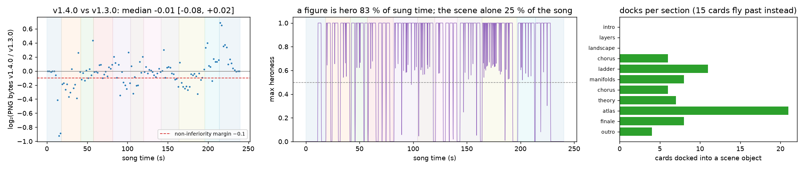

# Experiment 08: figure cards integrated into the scenes (dive-in hero shots)

**Question.** In v1.3.0 the 86 figure cards sat in corner boxes beside the main animation. Release v1.4.0 turns them into *hero shots*:
- each card dives out of the scene object its lyric names (a ladder rung, a theory pillar, an atlas star, a chorus circuit node, a manifold);
- it takes centre stage without a frame for at most 3.2 s while the camera pushes gently toward that object;
- it then recedes into depth, and at its end flies back and docks into the object.

The scenes themselves also gained concrete layers inside their general pictures. Examples:
- the loss surface's own saddle with its Hessian eigenvalues;
- the released grokking and double-descent curves;
- the real prompt tokens under the chorus circuits;
- GPT-2 token ids of the sung line in the layer tunnel;
- the 280-bit string collapsing into its program.

Three things need to hold:
1. The render still passes the automated verification.
2. The video keeps its visual detail. Moving content into the scenes must not make frames emptier.
3. The general scenes keep part of the frame, and the hero shots obey the balance rule set in the plan. A hero covers at most about 60 % of the frame, stays hero for at most 3.2 s, and at most 4 cards are active at once.

## Pre-specified checks

These were fixed in the approved plan and in this file **before** the v1.4.0 render and the comparison were run. The margin and the decision rule are committed with the scripts in [`scripts/validate_density.py`](../scripts/validate_density.py) and [`scripts/analysis/stats.py`](../scripts/analysis/stats.py) (`density_decision`).

1. **Render verification.** `out/anthem_verify.json` reports `ok: true`, using the unchanged criteria of [experiment 04](exp04_render_verification.md).
2. **Detail non-inferiority vs v1.3.0** (primary).
   - Frames are sampled every 2 s at the same timestamps in both videos, and each is PNG-encoded.
   - The statistic is the median paired log₂(bytes v1.4.0 / bytes v1.3.0).
   - Its 95 % CI comes from a bootstrap that resamples whole song sections.
   - **The test passes if the CI's lower bound is above −0.10.**
   - A margin of 0.10 log₂ units means at most about 7 % fewer PNG bytes per frame. This is the non-inferiority form recommended by CONSORT: the CI bound is compared with a margin fixed in advance ([Piaggio et al. 2012](https://doi.org/10.1001/jama.2012.87802)).
   - The baseline is the released v1.3.0 MP4. Its sha256 `3ecb6371…4c60` equals the digest GitHub lists for the [v1.3.0 asset](https://github.com/BurnyCoder/ambitious-science-of-information-processing-anthem/releases/tag/v1.3.0).
3. **Integration measures** (descriptive, computed from `timeline.json` with a Python mirror of the shot lifecycle).
   - **Definitions:**
     - a card "is the hero" while its heroness is ≥ 0.5;
     - heroness = emerge × (1 − min(1, rank)) × (1 − dock), as in [`video/src/stage/shots.ts`](../video/src/stage/shots.ts).
   - **Measures:**
     - share of sung time with a hero;
     - share of the whole song in which the general scene has the frame alone;
     - mean nominal frame coverage of the hero during sung time;
     - longest hero time of any card;
     - most cards active at once;
     - cards docked per section.
   - **Design checks** (pass/fail):
     - hero area ≤ 0.6 of the frame;
     - hero time ≤ 3.2 s plus half an ease (0.2 s) plus one frame;
     - ≤ 4 cards active at once.

**What would count against the change:**
- a failed render verification;
- a density CI lower bound ≤ −0.10, meaning frames became measurably emptier;
- a design check failing.

## Method

- **Shot lifecycle.** [`video/src/stage/shots.ts`](../video/src/stage/shots.ts) is a pure function of time with three node tests ([`video/tests/shots.test.ts`](../video/tests/shots.test.ts)).
  - [`scripts/analysis/shots.py`](../scripts/analysis/shots.py) mirrors it line for line.
  - The Python mirror reads the timing constants, hero scales, fly-through scenes and giant-lyric scenes from the TypeScript sources, so the two cannot drift apart silently.
  - [`tests/test_integration.py`](../tests/test_integration.py) repeats the TS test cases.
- **Anchors.** Each scene exports the geometry it draws, and [`video/src/stage/anchors.ts`](../video/src/stage/anchors.ts) reads it, so docks follow the drawn objects: the rotating atlas stars, the pillar boxes, the ladder rungs.
- **Nominal hero area.** The card box is 600 × 350 px (body 250 px + title, caption and lower third), scaled by the hero scale:
  - 1.8 in most scenes, giving 32.8 % of a 1920 × 1080 frame;
  - 1.38 in the chorus-type scenes, where giant words take the lower third, giving 19.3 %.
- **Density.** The method is unchanged from experiment 07 (PNG bytes as a complexity proxy, [Machado et al. 2015](https://doi.org/10.1016/j.actpsy.2015.06.005)). Only the decision rule changes, from superiority to non-inferiority.

## Results

Raw data: [`data/exp08_density.json`](data/exp08_density.json) and [`data/exp08_integration.json`](data/exp08_integration.json). Figure: [`figures/fig7_exp08.png`](figures/fig7_exp08.png).

| Check | Result |
|---|---|
| 1. Render verification | **pass**: render 10, 7212 frames, h264 1920×1080 30/1 + aac, 240.405 s for a 240.41 s song, 694 s wall time, 263.6 MB ([exp04](exp04_render_verification.md)) |
| 2. Density non-inferiority (primary) | **pass**: median log₂(v1.4.0 / v1.3.0) = −0.014, section-bootstrap 95 % CI [−0.075, +0.016]; the lower bound is above −0.10 |
| 3a. Hero area ≤ 0.6 of the frame | **pass**: 0.328 (most scenes), 0.193 (chorus, finale) |
| 3b. Hero time ≤ 3.2 s + 0.2 s + 1 frame | **pass**: longest 3.20 s |
| 3c. ≤ 4 cards active at once | **pass**: 4 |

**Density, in more detail.** The pre-specified test passes: the frames did not become emptier by more than the 0.10 margin. They also did not become richer. Details:
- The median moved slightly down (−0.014, about 1 % fewer PNG bytes), and only 47 of 120 paired frames are larger.
- The frame-level bootstrap, a secondary view that ignores the autocorrelation within sections, gives [−0.043, −0.002].
- **Per section, the change is not uniform.**
  - The finale (+0.133) and the outro (+0.111) gained detail: the bit rain, the frame-wide do()-graph, and the figure titles spiralling into the token.
  - Verse 1 (−0.191), the bridge (−0.111) and verse 2 (−0.094) lost bytes.
- *Post-hoc, untested explanation.* In those three sections v1.3.0 showed up to four corner cards at full brightness at once. v1.4.0 shows one hero over a scene dimmed to 72 % brightness, with smaller receded cards. Dimming alone lowers compressed size without removing any drawn element, so the proxy confounds "less detail" with "darker". Separating the two would need an ablation, a render with the dimming off, which was not run.

**Integration measures (descriptive):**
- **Hero time.** A figure is the hero during **82.6 %** of the sung time and 74.6 % of the whole song. The general scene has the frame to itself for **25.4 %** of the song: gaps between lines, instrumental passages, and the time after a card's 3.2 s of hero time before the next card arrives.
- **Coverage.** The mean nominal hero coverage over sung time is 23.3 % of the frame. A hero covers at most 32.8 % of it (nominal box), so even with a hero up, about two thirds of the frame shows the scene, pushed in by at most 8 %.
- **Docking.**
  - 71 of the 86 cards dock into a scene object: 6 + 6 chorus nodes, 11 ladder rungs and book, 8 manifolds, 7 theory pillars and plot, 21 atlas stars, 8 finale halo slots, and 4 into the outro token.
  - The 15 cards of the intro, verse 1 and pre-chorus 1 fly past the camera, because those scenes are fly-throughs.
- **Cards in motion.** At most 4 cards are active at once, as the lanes guarantee. Counting cards still flying back to dock, up to 6 are in motion at once (descriptive; not a design check).
- **Mirror check.** The Python mirror and `shots.ts` gave identical heroness on 2,400 samples (every 0.1 s) of the real timeline, with a maximum absolute difference of 0. This was a one-off check run with node during the experiment.

## What this does and does not show

- It shows that the hero-shot staging met its own design constraints and kept the video's overall detail within the pre-specified margin.
- It does not show that the video is easier to follow or more engaging. No viewer study was run, and PNG size measures detail, not quality.
- The 82.6 % hero share also means a figure is on stage most of the time. Whether that balance is right is a design judgement, and the user asked for a maximalist video. The measure is reported so the balance can be changed knowingly: `HERO_MAX_S` in `shots.ts` sets it.
- **Limitations.**
  - The hero area is a nominal box (600 × 350 px times the hero scale), not measured pixels.
  - Legibility was judged by the agent from 86 hero stills, 11 dock stills and the 11 verification stills, not by viewers.
  - The baseline is a single render of v1.3.0. Renders are deterministic, so there is no seed variance to estimate.

## Learnings

- **Stills catch layout; only motion catches jumps.**
  - Every layout defect in [exp04 iteration 4](exp04_render_verification.md) was found in stills.
  - The camera-origin jump at hero hand-overs was invisible in any single frame. It was found by reading the code: the origin was the current hero's anchor, and it switched at a heroness tie.
  - Making the origin a heroness-weighted average removed the discontinuity by construction.
- **A density proxy can move for reasons unrelated to content.** Dimming the scene is the obvious one here. Exp07 used the same proxy to show *more* detail. Here it is used only as a guard against *less*, and the per-section numbers are reported because the aggregate hides a −0.19 section.
- **Geometry exported from the scenes keeps anchors honest.** Ladder rungs, pillars, star projections and chorus nodes are imported by `anchors.ts`, so a card docks where the object is actually drawn. The theory pillars were first assigned by card order, which the code review flagged. They are now assigned by the direction named in the card's title.
