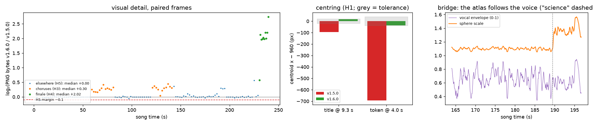

# Experiment 10: centred intro, a living chorus, theory timing, a voice-driven atlas and a grand finale (v1.6.0)

**Question.** After watching v1.5.0, the author asked for six changes:
- **0:04 and 0:09:** centre the intro's token and its title.
- **0:58:** replace the chorus's repetitive simple nodes with a detailed, dynamic, maximalist animation.
- **2:23:** start "solvable settings" early enough for its animation to finish.
- **3:10:** stop dimming the atlas, and let the graph of fields grow with the voice volume instead.
- **3:50:** finish with one maximalist overview of everything the video showed, with high-energy celebratory effects.

v1.6.0 makes these changes:
- **Intro:** the intro is laid out centred.
- **Chorus:** the chorus background becomes a 3D picture of the traced prompt flowing through the model, built on the released attribution graphs' token × layer coordinates.
- **Theory:**
  - solvable settings triggers on the first word of its line;
  - the blocks settle later;
  - each block's figure runs on a clock that finishes inside its open window.
- **Atlas:** the sphere's size follows the vocal envelope, measured on the Demucs vocal stem of the take the video uses (from exp06).
- **Finale:**
  - the rewind ends on the token;
  - from 230.25 s, a mosaic of every scene (live `<Freeze>` tiles) bursts out of the token, under fireworks, confetti, rays and glitter.

## Pre-specified checks

Fixed in the approved plan and in this file **before** any v1.6.0 render or comparison.

- **H0.** The render verifies, with the unchanged criteria of [exp04](exp04_render_verification.md).
- **H1, centring.** Frames are decoded from the MP4. Within each band, the horizontal centroid of bright pixels (luma > 160) must lie near x = 960:
  - **title band:** y 520–700 at 9.3 s, within ±1 % of the width;
  - **token band:** y 150–520 at 4.0 s, within ±2 % (the vector bars extend to one side).
- **H2, theory timing.** For each of the five directions, the time its block is open is ≥ its figure's animation length divided by its clock speed. This is a design check in pytest, from `timeline.json` and the body constants.
- **H3, chorus detail.** Frames every 2 s inside the two choruses are paired with the same timestamps of v1.5.0. The median log₂(PNG bytes v1.6.0 / v1.5.0) must be > 0, with a frame-bootstrap 95 % CI excluding 0. Frames are resampled because there are only two chorus sections.
- **H4, finale detail.** The same test on frames every 1 s from 230.5 to 239.5 s.
- **H5, elsewhere.** Every other frame every 2 s, against v1.5.0: the section-bootstrap 95 % CI lower bound of the median log₂ ratio must be > −0.10 (non-inferiority, as in exp08/09).
- **Descriptive:**
  - the vocal envelope and the sphere's scale over the bridge;
  - render time.

**What would count against the change:** any failure of H0–H5. In particular:
- a title still off-centre;
- a chorus or finale no more detailed than v1.5.0;
- detail lost elsewhere beyond the margin.

**Baseline.** v1.5.0: `out/v1.5.0/we-will-know-anthem.mp4`, sha256 `62453d86…c336`. This equals the digest GitHub lists for the [v1.5.0 asset](https://github.com/BurnyCoder/ambitious-science-of-information-processing-anthem/releases/tag/v1.5.0).

## What was built

| Request | Cause in v1.5.0 | Change in v1.6.0 |
|---|---|---|
| 0:04 visual not centred | The token column sat at x = 300 | The column unfolds at x = 960 (each row centres on it) and glides to x = 300 only when the tokens card appears (11 s) |
| 0:09 title not centred | Untyped letters were not laid out, the invisible cursor took width, and the letter-spacing after the last letter shifted the row | Every letter is laid out from the start (untyped ones invisible), the cursor is absolutely positioned, and extra left padding balances the trailing letter-spacing |
| 0:58 chorus: repetitive simple nodes | A 7 × 6 grid of dots | A 3D picture on the attribution graph's token × layer axes (Lindsey et al. 2025 coordinates: `ctx`, `layer`). Flickering feature clusters per cell, residual streams with flowing dots, attention arcs, and fading next-position columns are schematic. The circuit's supernodes, edges, labels, prompt and output are the released data. The camera orbits, with a downbeat zoom kick |
| 2:23 solvable settings too short | The card triggered on "solve" (143.6 s) and its block narrowed at 144.6 s (open about 1 s for a 2.5 s plot) | Trigger on "There", the line's first word, clamped to the section start (141.19 s, open 3.4 s). Blocks settle on "Predict" (159.2 s) instead of "mechanics". Each figure runs on a clock sped up (at most 1.6×) so it ends 0.3 s before its block narrows |
| 3:10 dimming; graph should grow with the voice | `dimNet` faded the network to 40 % | No dimming. The sphere scale is 1 + gain × vocal envelope: gain 0.15 in the bridge, rising to 0.6 from "science". The envelope is the RMS per video frame of exp06's Demucs vocal stem of the take the video uses (sha256 in `vocal_energy.json`), with the same `frame_rms` as the song's energy track, smoothed over 0.4 s. A dark outline keeps the amber statement legible |
| 3:50 maximalist overview and celebration | The rewind played the intro backwards onto the token; then a token, a statement and credits | The rewind's last cut lands on the token at the landing downbeat (230.25 s). Ten tiles burst out of it into a 4 × 3 mosaic, one per earlier section. Each tile is a `<Freeze>` copy of the video at that section's richest moment (most cards on screen), playing on at half speed. Also: all figure titles orbit the centre; fireworks burst on each downbeat; ARC-palette confetti, gold rays and glitter; a downbeat zoom punch. The statement and credits take the free centre cells, followed by a 1.5 s fade |

**Tests added:**
- `tests/test_vignettes.py::test_theory_blocks_finish_their_figures` (H2);
- `video/tests/overview.test.ts`:
  - ten tiles, each inside its section even after playing on;
  - on screen, non-overlapping, with the centre free;
  - each tile flies from the token into its cell.
- `video/tests/rewind.test.ts` now asserts that the rewind ends on the landing downbeat with its last cut on the token.

## Results

Render 13 is the v1.6.0 video: 7212 frames, h264 1920×1080 30/1 + AAC, 240.405 s, 356.6 MB, sha256 `52c9182a…6b1e`. It rendered in 588.7 s, as listed in [exp04](exp04_render_verification.md). Raw numbers are in [`data/exp10_finale.json`](data/exp10_finale.json) and the figure is `figures/fig9_exp10.png`.

| Check | Pre-specified criterion | Result | Verdict |
|---|---|---|---|
| H0 render | exp04 criteria | `verify` ok, no problems; no error or warning lines in the run log apart from the known `THREE.Clock` notice | **pass** |
| H1 title at 9.3 s | bright-pixel centroid within ±19.2 px of 960 | 976.0 px (+16.0); v1.5.0 864.8 (−95.2) | **pass** |
| H1 token at 4.0 s | within ±38.4 px | 922.9 px (−37.1); v1.5.0 266.2 (−693.8) | **pass, narrowly** |
| H2 theory windows | every block open ≥ its animation / its speed (speed ≤ 1.6) | `test_theory_blocks_finish_their_figures` passes | **pass** |
| H3 chorus detail | median log₂ ratio > 0, frame-bootstrap CI excludes 0 | +0.296 [+0.255, +0.314], 23 frames, all > 0 | **pass** |
| H4 finale detail | same | +2.016 [+1.980, +2.201], 10 frames | **pass** |
| H5 elsewhere | section-bootstrap CI lower bound > −0.10 | +0.000 [−0.003, +0.003], 92 frames | **pass** |

**What the numbers say:**
- **H1.**
  - Both bright-pixel centroids are now within tolerance. The token's margin is small (1.3 px).
  - Its column is centred row by row, but the squares (the brightest pixels) sit left of each row's centre and the dimmer bars to the right, so the bright-pixel centroid falls left of 960.
  - The title is 16 px right of centre: the extra left padding that balances the trailing letter-spacing slightly over-corrects.
- **H3.** In PNG bytes, every chorus frame is more detailed than in v1.5.0. The per-frame ratio ranges from +0.04 to +0.45, a factor of about 1.23 on the median.
- **H4.** The overview frames compress to about 4× the bytes of v1.5.0's frames at the same moments: median +2.02 log₂, where v1.5.0 showed a token, a statement and credits. The first frame (230.5 s, +0.57) is the burst, before the tiles have landed.
- **H5.**
  - Outside the choruses and the overview, frames are essentially unchanged: 9 of 9 section medians lie within ±0.02.
  - The individual frames that moved are the ones the requests touched: the theory blocks (up to +0.36), the bridge after "science" (≈ +0.3, the swelling, undimmed graph), and one rewind frame showing a chorus copy (+0.56).
- **Descriptive.**
  - Over the bridge the vocal envelope has mean 0.647 (10th–90th percentile 0.50–0.80).
  - Before "science" the sphere scale stays between 1.05 and 1.14. Once ramped up after it, the scale ranges from 1.27 to 1.57 and follows the voice (figure, right panel).

**Limitations:**
- PNG size measures detail, not quality or legibility. The overview is denser by construction: ten frames of the video in one.
- No viewer study was run.
- The H1 centroid is a proxy for "looks centred": it weights bright pixels, not shapes.
- The flicker, the attention arcs and the next-position columns of the chorus are schematic. Only the circuit, its positions, labels, prompt and output are released data.
- The sphere's gain values (0.15, 0.6) were chosen by eye before the render. They are not fitted to anything.

**Learnings:**
- **Layout width.** Layout bugs that make text "look off-centre" came from invisible elements taking width: the typing cursor, untyped letters, trailing letter-spacing. Laying out the final text from the start removes the drift entirely.
- **JSX whitespace.** A space before a JSX comment on the same line becomes a text node. Inside the per-letter spans it added a space after every letter and wrapped the title. The stills caught it before any render.
- **Case-insensitive paths.** On Windows, `stage/Overview.tsx` and `stage/overview.ts` resolve to the same module. The component file is now `OverviewLayer.tsx`.
- **Rendering cost.** Ten live `<Freeze>` copies of the whole video per frame rendered without trouble: render 13 took 588.7 s, against 624.6 s for render 12. The tiles' source moments stay more than 1 s from their section ends, so no premounted next scene adds WebGL contexts.
