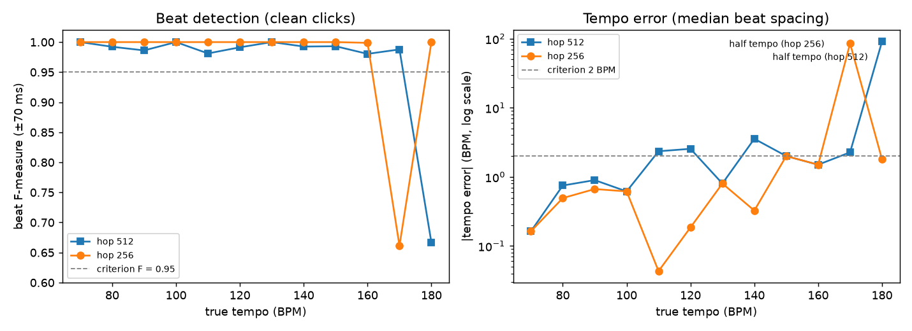
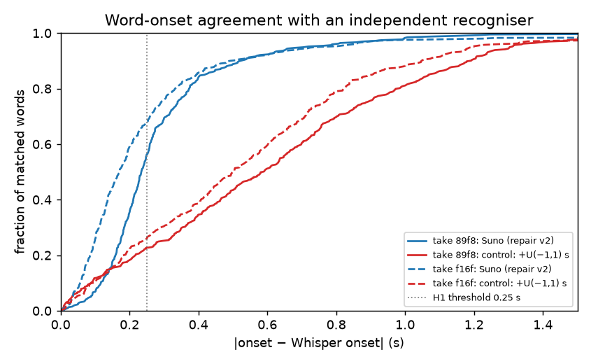
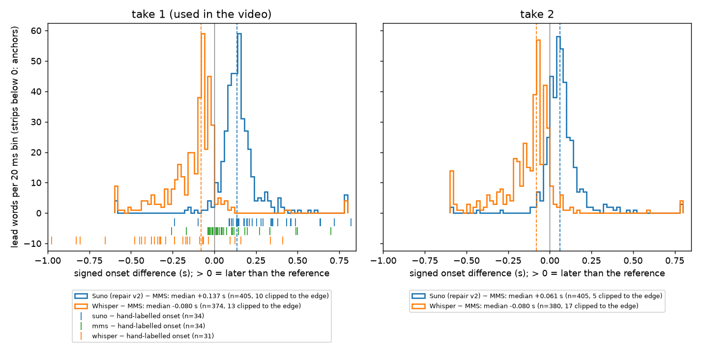
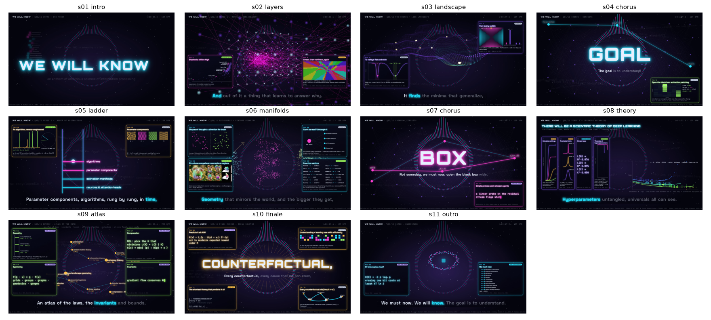
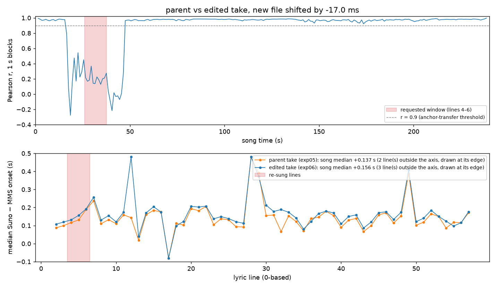

# 1. Introduction

**Context.** In 2026 a genre of short videos appeared in which a language model writes the code for every frame of an animated music video, usually with a song from Suno and React-based rendering through Remotion (e.g. the prompt collection *awesome-opus5-5-videos* on GitHub). Such videos stand or fall on *timing*: lyrics must light up when they are sung, and cuts must land on beats.

**The question.** Public descriptions of these videos report which tools were used. They do not report whether the timing is right, or how one would know.

**The subject of the song.** The song, *We Will Know*, is an anthem for an ambitious science of information processing. Its themes:

- the goal of fully reverse-engineering neural networks (leogao, 2025; Goodfire, n.d.);
- the *ladder of abstraction* from neurons and attention heads to behaviors and drives (Goodfire, n.d.);
- the five directions toward a scientific theory of deep learning (Simon et al., 2026);
- an atlas of the mathematics involved;
- "ideal solving": the shortest theory that predicts any behavior and any intervention (Kolmogorov, 1965; Pearl, 2009).

**Contributions.**

1. An open, single-command, reproducible pipeline: song, word timings, beats, timeline, deterministic render, automated verification. Paid generation is cached and tests run offline.
2. Pre-registered checks of the three timing components (take selection, beat tracking, word timing), each with an explicit falsification criterion, raw data and a control.
3. Two negative results reported in full:
   - a beat-tracker half-tempo failure inside the tested tempo range;
   - a word-timing repair rule that the test showed to be harmful.

   The repair finding changed what ships: without the test, 27 words of the video would have lit up 0.8–2.5 s late.
4. A pre-registered decomposition of a timing disagreement between two black-box systems. A third, lyrics-aware reference and blind hand-labelled anchors attribute it to both: the provider is late by 0.137 s and Whisper is early by 0.080 s. The resulting correction was applied to the video.
5. A pre-registered check of a one-line lyric edit made through the provider's section replacement. It shows that the edit reaches well beyond the requested window and invalidates per-take timing calibrations, which are re-estimated rather than assumed.
6. An illustration track whose "released data" cards are derived from pinned, hashed artifacts published with the cited papers, rather than from re-run experiments or invented plots. Each card carries a provenance badge, and the derived numbers were checked against the papers before release.

# 2. Background and related work

- **Beat tracking.** librosa (McFee et al., 2015) implements dynamic-programming beat tracking (Ellis, 2007). It builds an onset-strength envelope, picks a global tempo from an autocorrelation tempogram with a log-normal prior centred at 120 BPM, then places beats by dynamic programming. Beat accuracy is conventionally scored with an F-measure at a ±70 ms tolerance, the default in `mir_eval` (Raffel et al., 2014). Tempo estimation suffers from *metrical-level* (octave) ambiguity: half or double tempo is a common failure mode.
- **Lyric/word timing.** Whisper (Radford et al., 2023) yields word timestamps through cross-attention alignment. These are known to be imprecise, which motivated forced-alignment add-ons such as WhisperX (Bain et al., 2023). We therefore use Whisper only as an *independent, noisy* reference, never as ground truth.
- **Forced alignment and separation.** A forced aligner is given the transcript and only has to find *when* each word occurs. Here we use the CTC aligner of Massively Multilingual Speech (MMS_FA; Pratap et al., 2023), as packaged in torchaudio. CTC posteriors are "peaky", which can shift boundaries by a few frames (Huang et al., 2024).
  - Lyrics-to-audio alignment on polyphonic music works better on a separated vocal stem. Demucs-based systems reach mean word-onset errors of about 0.3 s on JamendoLyrics (Demirel et al., 2021), and the best systems reach below 0.2 s (Durand et al., 2023).
  - We separate with Hybrid Transformer Demucs (Rouard et al., 2022).
- **Programmatic video.** Remotion renders React components frame by frame in headless Chrome. A video is a pure function of the frame index, which allows parallel, deterministic rendering. Three.js scenes run via `@remotion/three` with the ANGLE GL backend.
- **Scientific content shown in the video.** Flat minima and generalization (Hochreiter & Schmidhuber, 1997; Keskar et al., 2017); circular features for days and months (Engels et al., 2024); linear space and time representations that are more accurate in larger models (Gurnee & Tegmark, 2023, §3.1); function vectors (Todd et al., 2023); the five research directions of "learning mechanics" (Simon et al., 2026). Since v1.3.0, each idea is shown on a figure card. The card uses released data where the authors or a well-known third party published it (§3.6), and is otherwise drawn as a labelled schematic or computed live from the formula.

# 3. Method

## 3.1 Pipeline

A Python wrapper (`uv run anthem`) runs four phases. The phases communicate only through files.

1. **song.**
   - Sends one `POST /api/v1/generate` with custom mode, V6, the hand-written lyrics (2701 characters, 11 sections, 58 lines, 430 words), a style string, negative tags and `duration: 240`.
   - Polls `record-info` until `SUCCESS`.
   - Downloads both takes and covers, and calls `get-timestamped-lyrics` for each take.
   - Caches everything, so no second paid call is ever made implicitly. All requests and responses are logged in full.
2. **timeline.**
   - Parses the lyrics, selects a take (§3.2), aligns the words (§3.3) and tracks beats (§3.4).
   - Starts each section at its first sung word minus 0.1 s, snapped to a beat if one is within ±0.3 s.
   - Writes `timeline.json`: sections and scenes, lines, words, beats, downbeats, and per-frame RMS and onset strength.
3. **render.**
   - Remotion 4.0.536 reads the timeline in `calculateMetadata`, so the video length equals the song length.
   - It stacks a starfield, faint drifting card titles, a spectrum ring, one scene per section, the figure cards (§3.6), a karaoke overlay (or giant kinetic words in the choruses), beat and cut flashes, a HUD and a citation ticker.
   - The scene layer punch-zooms on downbeats and is RGB-split for 0.25 s after each cut.
   - Render settings: `--gl=angle`, concurrency 8.
4. **verify.**
   - ffprobe acceptance checks, plus one still per section extracted with ffmpeg.

## 3.2 Take selection (fixed before generation)

The chosen take maximizes *coverage*, then minimizes `hootCer` (the provider's alignment score; lower is assumed better).

- **Coverage** is the share of written words, after normalization (lowercase, alphanumerics only), matched exactly to a provider word with `success=true`.
- **Why fix it.** Fixing the rule removes the freedom to pick whichever take makes the video look best.

## 3.3 Word alignment and repair

- **Cleaning and alignment.** Provider tokens arrive with section tags and line breaks glued on (e.g. `"[Verse 1]\nA "`). We strip the tags, split on whitespace, divide each entry's span evenly among its words, and align the result to the written words with `difflib.SequenceMatcher`.
- **Unmatched words.** Equal-length replace blocks are timed but not counted as matches. Deleted words are interpolated between their neighbours.
- **Repair v1** (pre-registered in exp03). A mid-line word longer than 1.2 s had its start moved to 0.5 s before its end. Any mid-line gap over 0.6 s pulled the earlier word up to its successor.
- **Repair v2** (post-hoc, §4.3). Only mid-line words longer than 3.0 s are moved. A preceding word follows only if its successor was moved.

## 3.4 Beats

- **Tracking.** `librosa.beat.beat_track` on the onset-strength envelope at 22.05 kHz with hop 256, chosen after the first unit test failed at hop 512 (§4.2).
- **Tempo.** Reported as 60 / median inter-beat interval.
- **Downbeats.** Every 4th beat, phase chosen by the summed onset strength. This is a heuristic that assumes 4/4.

## 3.5 Parameters and their rationale

| Parameter | Value | Rationale |
|---|---|---|
| Song duration | 240 s | ~4-minute anthem; the API default of 20 s must be overridden |
| Video | 1920×1080, 30 fps | YouTube 1080p; 33.3 ms frame = the timing resolution the viewer sees |
| Hop size | 256 samples (11.6 ms) | Exp02: beats within 1 video frame; half the tempo-quantization error of 512 |
| Section lead / snap window | 0.1 s / ±0.3 s | Cut slightly before the first sung word; never move a cut more than ~half a beat |
| Repair v2 thresholds | 3.0 s; follow if gap > 0.6 s; repaired duration 0.5 s | 3.0 s is more than 6 beats at 129 BPM; 0.5 s is about one beat |
| H1 threshold | 0.25 s | About half a beat; set before running, given the expected noise in Whisper's timestamps |
| Word-time offset (`VIDEO_WORD_OFFSET_S`) | −0.156 s (code default 0) | Exp05's pre-registered decision rule, re-run on the edited take in exp06 (−0.137 s on its parent, take 1) |
| Replace-section window (exp06) | 25.97–37.60 s (lines 4–6) | Gap midpoints around the re-sung lines; the API needs ≥ 10 s, and lines 5–6 alone span 7.6 s |
| MMS_FA windows (exp05) | 30 s + 2 s context per side | Avoids full self-attention over 12 000 frames; the same scheme as `ctc-forced-aligner` |
| Exp05 decision thresholds | \|δ\| ≥ 1 frame (33 ms); \|β\| ≤ 0.05 s; ≥ 10 anchors | One frame is the smallest error the viewer can see; 1.5 frames of bias is tolerated in the reference |
| Beat F window | ±70 ms | `mir_eval` default |
| Seeds (exp02) | 5 per cell | Enough to expose noise sensitivity; the observed between-seed SD was about 0 |

## 3.6 Illustration track and released data (v1.3.0)

**Placement.**
- `content/vignettes.toml` declares 86 cards. Each has a trigger regex on a sung word (optionally its n-th match in the section), a named slot box, a hold time, a title, text, a provenance badge and a citation.
- A card appears 0.15 s before its word.
- It ends at its section's cut, unless that would leave it on screen for less than 2 s.
- Of two cards in the same slot, the earlier ends where the later begins.
- Placement fails loudly if a trigger is never sung.
- Coverage is the share of sung non-backing lines with a card triggered by one of their words. Its pre-specified target was 1.0.

**Badges.**
- *released data*: read from files released by the authors or a well-known third party.
- *published numbers*: quoted from a paper's text or tables.
- *live math*: computed in the video.
- *from the paper*: a formula or claim.
- *schematic*: our illustration.

**Data rule (set by the author).**
- Never re-run an experiment whose models, results or data exist.
- Prefer the original authors and well-known third parties.
- Retrain only if nothing usable exists. Nothing had to be retrained.

`scripts/vignette_data.py` downloads 31 pinned files (523.8 MB) and records URL, revision, licence, size and sha256 for each. Downloaded `.pth` files load with `weights_only=True`. A pickle loads only through an unpickler that refuses every global except numpy reconstruction.

The derived card data comes from these sources:
- the Nanda et al. (2023) mainline grokking run: loss curves, and the Fourier spectrum of the embedding every 1,000 epochs;
- the three attribution graphs behind Lindsey et al. (2025), collapsed to the authors' supernodes (also used to drive the chorus circuits);
- ARENA's per-head induction scores for GPT-2 small;
- Neuronpedia SAE latents for the days of the week (Engels et al., 2024);
- Epoch AI's model dataset;
- Epoch's 245 points extracted from Hoffmann et al. (2022), drawn with both published parametric fits (Hoffmann et al.; Besiroglu et al., 2024);
- Nakkiran et al.'s (2019) double-descent runs;
- Gurnee & Tegmark's place coordinates;
- Todd et al.'s antonym pairs;
- Arditi et al.'s refusal scores;
- WeightWatcher's per-layer exponents (Martin & Mahoney, 2021);
- the saved toy-superposition figure in Elhage et al.'s (2022) notebook;
- Goodfire's block-sparse-featurizer figure;
- the GPT-2 tokenizer.

# 4. Experiments and results

## 4.1 Generation and selection (exp01)

- **Generation.** One task took 62 s from submission to `SUCCESS` and returned two takes: 240.40 s and 239.92 s.
- **Alignment entries.** The provider returned 431 and 439 aligned entries, with `success=true` for all of them.
- **Selection.** After cleaning, both takes covered 430/430 written words, so coverage tied at 1.0. The tie-break chose take 1 (hootCer 0.155 vs 0.165). Coverage turned out to be uninformative for this provider, and we do not claim that take 1 is musically better.
- **Section order.** The section boundaries recovered from take 1 follow the written section order.
- **Artifacts.**
  - Take 2 aligned its first line twice.
  - In take 1, "matrix" spanned 7.74 s and began inside the intro.

## 4.2 Beat tracker vs ground truth (exp02)

**Discovery.** A unit test written before the implementation (a 120 BPM click track, ±2 BPM) failed with 117.45 BPM. At hop 512 the tempogram's integer lag is 22 frames, and 43.07 · 60 / 22 = 117.45.

**Systematic run.** 30-s click tracks at 70–180 BPM. Pre-registered criterion: at hop 256 on clean clicks, every run must have |error| ≤ 2 BPM and F ≥ 0.95.

- **Overall: FAIL.** 11 of 12 tempos passed.
- **The failure is a half-tempo lock.** At 170 BPM the tracker reported 85 BPM, with F = 0.661 (precision 1, recall 0.5). The same failure occurred at 180 BPM at hop 512 and on noisy clicks at hop 256.
- **Hop 512 quantization.** Tempo errors reached ±3.55 BPM.
- **The estimator does not remove it.** The median-spacing and tempogram estimators were identical in every cell, both locked to whole-frame periods. This corrects a claim in our own code comments.
- **Post-hoc slope estimator.** A least-squares slope of beat time vs index reduced the error to ≤ 0.01 BPM wherever the metrical level was correct. Since it was found post hoc, the pipeline keeps the pre-specified estimator.
- **Timing precision.** At hop 256, median beat deviation was 15–19 ms (clean) and 23–25 ms (noisy), below one frame.
- **Seed variance.** It was about 0 for tempo and at most ±0.021 for F.
- **The song.** It measures 129.3 BPM (506 beats), inside the validated range. Suno's own style tag says 124 BPM, which argues against a half or double error.

{width=95%}

## 4.3 Word-onset agreement and the repair (exp03)

**Pre-registered design.**

- faster-whisper `small.en` (CPU int8) transcribed each take's full mix. It has no access to the lyrics.
- Written and recognized words were matched by text (exact difflib blocks).
- **H1:** median |onset − Whisper onset| ≤ 0.25 s per take.
- **H2:** on repaired words, the repair reduces |Δ| (one-sided Wilcoxon, α = 0.05).
- **Control:** U(−1, 1) s random shifts.

| | Take 1 (video) | Take 2 |
|---|---|---|
| Whisper words / matched pairs | 440 / 393 | 435 / 401 |
| Median \|Δ\| raw [95% bootstrap CI] | 0.235 s [0.225, 0.248] | 0.172 s [0.153, 0.190] |
| Median \|Δ\| repair v1 | 0.242 s [0.227, 0.257] | 0.179 s [0.158, 0.195] |
| Median \|Δ\| repair v2 | 0.235 s [0.225, 0.248] | 0.172 s (no repairs) |
| Median \|Δ\| random-shift control (with v2) | 0.590 s | 0.500 s |
| Share ≤ 0.25 s / ≤ 0.5 s (v2) | 56.2 % / 88.8 % | 67.8 % / 90.0 % |

**H1 passed for both takes.**

**H2 was falsified for repair v1.** Over 43 repaired and matched words (both takes), the median paired change was −1.14 s, i.e. *worse*, with Wilcoxon p ≈ 1.0.

- **Diagnosis.** The 1.2 s threshold flagged real sung notes, e.g. "go" at 1.64 s. Shortening them opened gaps that cascaded the earlier words of those lines 0.8–2.5 s late (27 words in take 1). Whisper and the raw timings agreed on the true positions.
- **v2.** It touches only "A" and "matrix" in take 1, and moves both toward the reference: |Δ| 6.33 → 1.07 s and 6.81 → 0.43 s.
- **v2 is post-hoc and descriptive only.** The intended held-out take (take 2) contains no word that v2 would repair, so no confirmatory test was possible.

**Post-hoc analysis.** The signed differences show the disagreement is mostly a constant lag: Suno is later than Whisper for 98.5 % (take 1) and 93.8 % (take 2) of words, by a median of 0.234 s and 0.165 s. Around that lag, the spread is only 0.075 s and 0.089 s. Exp03 could not tell which system was biased, so it applied no correction; §4.4 settles this.

{width=70%}

## 4.4 Which side carries the lag? (exp05)

**Pre-registered design** (committed before any separation or alignment ran).

- **Vocal stem.** Demucs `htdemucs` (default settings, CPU) separates each take; the stems sum back to the mix with a 0-sample lag.
- **Forced alignment.** torchaudio's MMS_FA force-aligns all 430 written words on the 16 kHz vocal stem. Emissions are computed in 30 s windows with 2 s of context per side (cropped), then one CTC Viterbi pass covers the whole song.
- **Whisper.** Re-run as in exp03. It reproduced exp03's medians exactly (0.2335 s and 0.1646 s).
- **Primary metric.** δ = median(Suno − MMS) over the 405 lead words of take 1. The 95 % CI comes from resampling the 56 lines (10 000 resamples).
- **Hypotheses.** H_S (Suno late) predicts δ ≈ +0.23 s. H_W (Whisper early) predicts δ ≈ 0 and is falsified if the CI lies above +0.05 s.
- **Anchor check.** The MMS timing itself is checked against *anchors*: acoustic onsets of line starts, hand-labelled blind on plots of the vocal stem. The plots show no candidate positions, and the window centre is jittered.
- **Decision rule.** Shift every word by −δ iff all four hold: the CI excludes 0; |δ| ≥ one frame; MMS is within 0.05 s of the anchors (≥ 10 anchors); and the anchors agree on the sign.

**Amendment.** The pre-registered anchor rule required a ≥ 0.8 s rest before the line in both Suno's and MMS's timings, and only 1 of 56 line starts qualified. Suno's word spans are nearly contiguous (median gap 0.06 s), so the rule could not work. Before any comparison was computed, it was replaced by "all 56 lead line starts, ambiguous ones excluded by the annotator". Of the 56, 34 were labelled and 22 were marked ambiguous.

| | Take 1 (video) | Take 2 |
|---|---|---|
| δ = median(Suno − MMS) [line-cluster CI] | **+0.137 s [0.125, 0.147]** | +0.061 s [0.052, 0.070] |
| Whisper − MMS | −0.080 s [−0.100, −0.080] | −0.080 s [−0.100, −0.080] |
| Share with Suno later / spread around δ | 96.0 % / 0.046 s | 85.2 % / 0.044 s |
| Drift, Spearman ρ(time, d) | −0.002 (p = 0.96) | −0.083 (p = 0.095) |
| \|Suno − MMS\| vs random-shift control | 0.140 s vs 0.563 s | 0.065 s vs 0.543 s |
| Anchors (n = 34): Suno / MMS / Whisper − anchor | +0.220 / +0.041 / −0.292 s | – |

**Decision.** All four conditions held: CI [0.125, 0.147]; |δ| = 0.137 s; β = 0.041 s with 34 anchors; α_S = +0.220 s [0.148, 0.347]. Every word of the video was therefore shifted by **−0.137 s** (`VIDEO_WORD_OFFSET_S`), and the video was re-rendered. Under the anchor rule as originally written, D3 would have failed and nothing would have changed.

**Hypotheses.** H_W is falsified. H_S survives, but with a smaller effect than it predicted: the 0.23 s Suno–Whisper lag splits into about 0.14 s of provider lateness and about 0.08 s of Whisper earliness. Whisper is earliest at line starts (−0.29 s against the anchors), which fits its known habit of absorbing a preceding pause into the next word.

**Post hoc.** The anchors were not used to estimate δ, so they test the correction out of sample.

- The median |Suno − anchor| fell from 0.233 s to 0.131 s; 32/34 anchors improved; one-sided Wilcoxon p = 9 × 10⁻⁷.
- At line starts the corrected onsets remain late by +0.083 s [0.011, 0.210].
- The lag is take-specific (0.137 vs 0.061 s), while Whisper's bias is identical on both takes. The offset is therefore a property of the provider's per-take alignment, and it is calibrated for take 1 only.

{width=100%}

## 4.5 Render and verification (exp04)

**Iteration before the full render.** Section-midpoint stills, inspected visually, exposed six layout defects (Table in exp04), all fixed before the full render. Examples: overflowing kinetic words, a lattice-trail oscillation caused by too large a step size, and the ladder colliding with the lyrics.

**Final render.**

- 7213 frames, H.264 + AAC, 1920×1080, 30/1 fps.
- Container duration 240.45 s against a 240.42 s song, which passed the ≤ 0.5 s criterion.
- The v1.0.0 render took 347.3 s (217.6 MB) on a 16-thread desktop with 8 headless-Chrome tabs; an earlier render with v1 timings took 453.6 s.
- The v1.1.0 render with the exp05 offset took 485.0 s (217.8 MB), had the same container duration, and passed the same checks.
- The v1.2.0 render of the edited take (exp06) with the −0.156 s offset has 7212 frames and a container duration of 240.405 s for a 240.41 s song. It took 467.8 s (218.0 MB) and passed the same checks. Its audio track is 23.0 ms later than the analysed MP3 decoding.
- The MP4's audio track is 11.0 ms later than the analysed MP3 decoding (cross-correlation, first 60 s), a third of a frame. It is reported, not corrected.
- The automated check passed.
- The v1.3.0 render with the illustration track has 7212 frames and a 240.405 s container duration. It took 531.4 s (244.4 MB) and passed the same checks. Before it, a still of every card (86) was inspected. That found ten layout defects, among them overlapping graph labels, a truncated bar axis and a schematic leaving its axis (exp04, iteration 3).

{width=100%}

## 4.6 One-line lyric edit by section replacement (exp06)

**Motivation.** The author asked that the word "mind" not appear in the lyrics. It occurred once, in Verse 1 line 5. The new line is "And out of it a **thing** that learns to answer why", which keeps the meter and the rhyme. Regenerating the song would have voided exp02–exp05 for the video's take. The provider instead offers a *replace-section* operation, which re-sings a window of ≥ 10 s of an existing take with new lyrics and, per its documentation, blends it with the rest (sunoapi.org, n.d.).

**Design (pre-registered).**

- **Window.** Lines 4–6, from gap midpoint to gap midpoint in audio time: 25.97–37.60 s.
- **Request.** One paid call, with segment lyrics and the full new lyrics.
- **Checks.** (a) full-length take; (b) the kept audio is the same and on the same timebase (FFT cross-correlation lag ≤ 1 ms, r ≥ 0.95); (c) the provider's word times outside the window are unchanged (median |Δ| ≤ 20 ms); (d) Whisper does not hear "mind" in the window; (e) coverage ≥ 0.99.
- **Decision.** The exp05 offset carries over only if b and c pass. Otherwise exp05 is re-run on the new take.
- **Guard.** A `banned_words` list now stops the pipeline before any paid call if the lyrics contain the word.

**Amendments** (both stated in the report before the analysis they govern).

1. The call returned two takes: a 240.40 s edit and a 469.52 s take that sings the song about twice. Check a was applied per take and the doubled take was dropped. The pre-specified take rule would have chosen the same take: coverage tied at 1.0, and hootCer was 0.148 vs 0.871.
2. Check b failed, so exp05's phases were re-run on the new take: Demucs + MMS_FA δ with the line-cluster bootstrap, and exp05's decision rule unchanged. The anchors were exp05's blind hand labels moved by the measured lag. An anchor was kept only where the surrounding audio is the parent's: lag-aligned per-second r ≥ 0.9 in its second and both neighbours, local lag within 1 ms of the global lag, and local r ≥ 0.9.

**Results.**

| Check | Result |
|---|---|
| a | 240.40 s (the 469.52 s take dropped) |
| b | **fail**: lag −17.0 ms in both kept regions; r = 0.637 (0–25 s), 0.962 (38.6–239 s); lag-aligned per-second r < 0.9 exactly in seconds 16–46 |
| c | median \|Δ\| = 0.000 s (n = 401): the word times are the parent's |
| d | Whisper: "… and out of it a **thing** that learns to answer why …" (parent, same window: "… are **mine** and learns …") |
| e | coverage 1.0 |
| δ re-estimated (405 lead words) | +0.156 s [0.144, 0.167], no drift (ρ = −0.02); parent +0.137 s [0.125, 0.147] |
| anchors | 26 of 34 transferred (all 8 failures in 16–46 s); β = +0.035 s [−0.011, 0.075]; α_S = +0.221 s [0.162, 0.377] |
| decision | D1–D4 hold; offset **−0.156 s** |

**Interpretation.**

- The edit is a successful causal intervention on one line, but not a local one: about 30 s of audio was regenerated.
- In the blend zone the vocal phrasing survived. On every lead line from 2 to 11, the MMS onsets moved by 0.01–0.02 s (one MMS frame) against the parent, and Whisper recovers the written words.
- The provider's word times were not re-measured outside the window. Since the file moved 17 ms earlier, Suno − MMS grew by the same amount.
- On the same 26 anchors, α_S grew by 17 ms (+0.204 → +0.221 s), while β, which compares two audio-derived onsets, stayed within one frame (+0.041 → +0.035 s). This is what a pure file shift predicts.

{width=100%}

## 4.7 Figure cards from released data (exp07)

**Pre-specified checks** (fixed in the plan before the data phase ran):
1. The five largest Fourier frequencies of the released epoch-40k embedding equal the paper's key frequencies.
2. ARENA's five highest induction scores include IOI's induction heads 5.5 and 6.9 (Wang et al., 2022).
3. Every on-screen number matches its source.
4. Coverage is 1.0.
5. Paired frames of v1.3.0 compress to more PNG bytes than v1.2.0 frames at the same timestamps: median log₂ ratio > 0, with a section-bootstrap 95 % CI excluding 0.

The fifth check uses a standard proxy for visual complexity (Machado et al., 2015).

| Check | Result |
|---|---|
| 1 | **pass**: {14, 35, 41, 42, 52}; the 6th largest is 31 |
| 2 | **pass**: 5.5 = 0.909, 6.9 = 0.898, 5.1 = 0.897, 7.10 = 0.891, 7.2 = 0.825 |
| 3 | **pass after corrections**: a Golden Gate quote and clamp value, an ActAdd layer and coefficient, and a "2–6 = well trained" band for WeightWatcher's α were in our plan but not in the cited sources, and were removed or corrected |
| 4 | **pass**: 56/56 lines, 86 cards, the shortest on screen for 2.0 s |
| 5 | **pass**: +0.264 [+0.183, +0.422]; frame bootstrap [+0.208, +0.343]; 113/120 frames larger; per section from +0.002 (verse 1) to +0.635 (bridge) |

**Descriptive numbers from the released data** (not pre-registered):
- **Weight decay.** With weight decay 1.0, test loss first drops below 1 at epoch 9,890; with 0.1, at epoch 90,890. The runs also differ in seed, and the 0.1 run's stored config is stale.
- **Double descent.** Test error falls to 0.219 at width 4, peaks at 0.303 at width 10, and reaches 0.163 at width 64 (5 trials).
- **Refusal.** Ablating the refusal direction raises JailbreakBench answers without a refusal phrase from 5 % to 100 % (LlamaGuard-2 judge: 3 % to 82 %).

{width=100%}

# 5. Discussion

**What the evidence supports.**

- The pipeline renders a valid, song-length video deterministically.
- Its beat times are accurate to under one frame on click tracks between 70 and 160 BPM.
- Its word onsets agree with an independent recogniser to about a quarter of a second (median), clearly better than chance. Most of that disagreement is a constant 0.17–0.23 s lag, around which relative timing agrees to about 0.08 s (post-hoc).
- That lag is shared between the two systems. Against a lyrics-aware forced alignment of the separated voice, the provider is 0.137 s late on the original video take and Whisper is 0.080 s early. A pre-registered global correction of −0.137 s moved 94 % of independently hand-labelled line starts closer.
- Concrete content can be added without re-running anyone's experiment. Released artifacts covered every "real data" card, and the two checks that could fail against the papers passed.
- The video's line was changed with a one-call section replacement. Because the provider shifted the file and copied its old word times, the correction had to be re-estimated (−0.156 s) and could not be carried over.

**What it does not support.**

- Any claim about musical quality.
- Any general claim about what replace-section changes: one call is an existence proof, not a characterisation.
- Any general claim about Suno's alignment accuracy. The lag differed between the two takes of one generation (0.137 vs 0.061 s), so a per-take measurement is needed, not a constant.
- Frame-exact karaoke. The forced aligner itself sits about 0.04 s after the hand-labelled onsets, and line starts remain about 0.08 s late after the correction.
- The beat accuracy on the actual orchestral mix, which has no ground truth.
- Any claim that the denser video is better or easier to follow: compressed size measures detail, not quality, and no viewer study was run.

**The most useful outcome was negative.** A reasonable-looking heuristic, written to fix visible artifacts, made things worse on 43 words. Only an independent reference and a pre-stated test revealed this. The general lesson for code-animated music videos is to treat every timing transformation as an intervention and to measure it against something independent, not against the same signal it was designed from.

# 6. Limitations

- **Sample size.** One generation (n = 1 task, 2 takes) and one song. Nothing here estimates population-level behaviour of Suno or of the provider.
- **Reference quality.** The Whisper reference is noisy: sung vocals over an orchestral mix, and timestamps from cross-attention. Exp05 therefore added a lyrics-aware forced aligner on a separated vocal stem.
  - That aligner was trained on read speech. Its absolute timing was checked only at 34 line starts.
  - The anchors were hand-labelled by the agent from plots of the vocal stem, not by listening, and 22 of 56 were too ambiguous to label.
  - The anchor-selection rule had to be amended after its first run, though before any comparison.
- **Synthetic beat test.** Click tracks lack the onsets and tempo drift of real music, and downbeats rely on a 4/4 heuristic that was not validated.
- **Exp06 amendments.** Both were written after seeing part of the data: the duration check after seeing the two durations, and the anchor transfer after seeing check b. The transfer reuses labels made on the parent take. It is valid only where the audio is the parent's shifted by a constant, which is checked per anchor. No new blind labels were made for the edited take.
- **Post-hoc analyses.** Repair v2 and the slope tempo estimator were designed after seeing data. Both are labelled as post-hoc throughout, and no confirmatory claim is made about them.
- **Illustration track.** Several released files state no licence. Only small derived numbers are committed, with attribution on screen.
  - Schematic cards illustrate ideas; they are not data.
  - The weight-decay comparison rests on one run per setting, with different seeds.
  - Legibility of 2–6 s cards was judged by the agent from stills, not by viewers.
- **Black-box components.** Schematic content is labelled per card. The music model and the provider are black boxes, and hootCer's definition is undocumented.

# 7. Conclusion

A code-animated music video can be built as an ordinary, testable data pipeline:

- the paid generative step is cached;
- the timing components are validated against references fixed in advance;
- the render is deterministic and checked automatically.

Doing so turned up a quantization bug, a half-tempo failure mode, a harmful repair heuristic, and a 0.137 s lag in the provider's word onsets that is now corrected. A later one-line lyric edit added a fifth finding: the provider's edit moved the whole file by 17 ms and regenerated far more than the requested window, while reporting the old word times. None of these would have been visible from the finished video's description. Adding concrete, cited content showed the same pattern: a fact-check of our own plan against the cited sources removed three overclaims before release. Code, data, logs-derived reports and the video are available at <https://github.com/BurnyCoder/ambitious-science-of-information-processing-anthem>.

# References

- Arditi, A., Obeso, O., Syed, A., Paleka, D., Panickssery, N., Gurnee, W., & Nanda, N. (2024). Refusal in language models is mediated by a single direction. arXiv:2406.11717. Data: <https://github.com/andyrdt/refusal_direction>.
- ARENA (2024). Induction-head scores for GPT-2 small. <https://info-arena.github.io/ARENA_img/misc/media-12/1206-A.html> (accessed 27 Oct 2026).
- Bain, M., Huh, J., Han, T., & Zisserman, A. (2023). WhisperX: Time-accurate speech transcription of long-form audio. *INTERSPEECH 2023*. arXiv:2303.00747.
- Ashraf, M. (2024). ctc-forced-aligner. <https://github.com/MahmoudAshraf97/ctc-forced-aligner> (accessed 18 Oct 2026).
- Besiroglu, T., Erdil, E., Barnett, M., & You, J. (2024). Chinchilla scaling: A replication attempt. arXiv:2404.10102. Data: <https://github.com/epoch-research/analyzing-chinchilla>.
- Bricken, T., et al. (2023). Towards monosemanticity: Decomposing language models with dictionary learning. *Transformer Circuits Thread*.
- Demirel, E., Ahlbäck, S., & Dixon, S. (2021). Low resource audio-to-lyrics alignment from polyphonic music recordings. arXiv:2102.09202.
- Durand, S., Stoller, D., & Ewert, S. (2023). Contrastive learning-based audio to lyrics alignment for multiple languages. arXiv:2306.07744.
- Elhage, N., et al. (2022). Toy models of superposition. *Transformer Circuits Thread*. arXiv:2209.10652. Notebook: <https://github.com/anthropics/toy-models-of-superposition>.
- Ellis, D. P. W. (2007). Beat tracking by dynamic programming. *Journal of New Music Research*, 36(1), 51–60.
- Field, C. A., & Welsh, A. H. (2007). Bootstrapping clustered data. *Journal of the Royal Statistical Society: Series B*, 69(3), 369–390.
- Engels, J., Michaud, E. J., Liao, I., Gurnee, W., & Tegmark, M. (2024). Not all language model features are one-dimensionally linear. arXiv:2405.14860.
- Epoch AI (2026). Notable AI Models dataset. <https://epoch.ai/data/ai-models> (CC BY 4.0; accessed 27 Oct 2026).
- Goodfire (2026). block-sparse-featurizer. <https://github.com/goodfire-ai/block-sparse-featurizer> (MIT).
- Goodfire (n.d.). We can and must solve alignment. <https://www.goodfire.com/blog/we-can-and-must-solve-alignment> (accessed 18 Oct 2026).
- Gurnee, W., & Tegmark, M. (2023). Language models represent space and time. arXiv:2310.02207.
- Hoffmann, J., et al. (2022). Training compute-optimal large language models. arXiv:2203.15556.
- Hochreiter, S., & Schmidhuber, J. (1997). Flat minima. *Neural Computation*, 9(1), 1–42.
- Huang, R., Zhang, X., Ni, Z., Sun, L., Hira, M., Hwang, J., Manohar, V., Pratap, V., Wiesner, M., Watanabe, S., Povey, D., & Khudanpur, S. (2024). Less peaky and more accurate CTC forced alignment by label priors. *ICASSP 2024*. arXiv:2406.02560.
- Keskar, N. S., Mudigere, D., Nocedal, J., Smelyanskiy, M., & Tang, P. T. P. (2017). On large-batch training for deep learning: Generalization gap and sharp minima. *ICLR 2017*. arXiv:1609.04836.
- Kaplan, J., et al. (2020). Scaling laws for neural language models. arXiv:2001.08361.
- Kolmogorov, A. N. (1965). Three approaches to the quantitative definition of information. *Problems of Information Transmission*, 1(1), 1–7.
- leogao (2025, December 5). An ambitious vision for interpretability. *LessWrong*. <https://www.lesswrong.com/posts/Hy6PX43HGgmfiTaKu/an-ambitious-vision-for-interpretability>.
- Lindsey, J., et al. (2025). On the biology of a large language model. *Transformer Circuits Thread*. <https://transformer-circuits.pub/2025/attribution-graphs/biology.html>.
- Machado, P., Romero, J., Nadal, M., Santos, A., Correia, J., & Carballal, A. (2015). Computerized measures of visual complexity. *Acta Psychologica*, 160, 43–57.
- Martin, C. H., & Mahoney, M. W. (2021). Implicit self-regularization in deep neural networks. *JMLR*, 22(165). Data: <https://github.com/CalculatedContent/ww-trends-2020>.
- McFee, B., Raffel, C., Liang, D., Ellis, D. P. W., McVicar, M., Battenberg, E., & Nieto, O. (2015). librosa: Audio and music signal analysis in Python. *Proc. 14th Python in Science Conference*.
- Nakkiran, P., Kaplun, G., Bansal, Y., Yang, T., Barak, B., & Sutskever, I. (2019). Deep double descent. arXiv:1912.02292. Data: <https://gitlab.com/harvard-machine-learning/double-descent>.
- Nanda, N., Chan, L., Lieberum, T., Smith, J., & Steinhardt, J. (2023). Progress measures for grokking via mechanistic interpretability. *ICLR 2023*. arXiv:2301.05217. Run: <https://huggingface.co/callummcdougall/grokking_full_run_data>.
- Nanda, N., Lee, A., & Wattenberg, M. (2023). Emergent linear representations in world models of self-supervised sequence models. arXiv:2309.00941.
- Olsson, C., et al. (2022). In-context learning and induction heads. *Transformer Circuits Thread*. arXiv:2209.11895.
- Pearl, J. (2009). *Causality: Models, reasoning, and inference* (2nd ed.). Cambridge University Press.
- Pratap, V., et al. (2023). Scaling speech technology to 1,000+ languages. arXiv:2305.13516.
- Radford, A., Kim, J. W., Xu, T., Brockman, G., McLeavey, C., & Sutskever, I. (2023). Robust speech recognition via large-scale weak supervision. *ICML 2023*. arXiv:2212.04356.
- Power, A., Burda, Y., Edwards, H., Babuschkin, I., & Misra, V. (2022). Grokking: Generalization beyond overfitting on small algorithmic datasets. arXiv:2201.02177.
- Raffel, C., McFee, B., Humphrey, E. J., Salamon, J., Nieto, O., Liang, D., & Ellis, D. P. W. (2014). mir_eval: A transparent implementation of common MIR metrics. *ISMIR 2014*.
- Simon, J., Kunin, D., Atanasov, A., Boix-Adserà, E., Bordelon, B., Cohen, J., Ghosh, N., Guth, F., Jacot, A., Kamb, M., Karkada, D., Michaud, E. J., Ottlik, B., & Turnbull, J. (2026). There will be a scientific theory of deep learning. arXiv:2604.21691.
- Templeton, A., et al. (2024). Scaling monosemanticity: Extracting interpretable features from Claude 3 Sonnet. *Transformer Circuits Thread*.
- Todd, E., Li, M. L., Sharma, A. S., Mueller, A., Wallace, B. C., & Bau, D. (2023). Function vectors in large language models. arXiv:2310.15213 (ICLR 2024).
- Turner, A. M., et al. (2023). Steering language models with activation engineering. arXiv:2308.10248.
- Wang, K., Variengien, A., Conmy, A., Shlegeris, B., & Steinhardt, J. (2022). Interpretability in the wild: A circuit for indirect object identification in GPT-2 small. arXiv:2211.00593.
- Rouard, S., Massa, F., & Défossez, A. (2022). Hybrid transformers for music source separation. arXiv:2211.08553.
- sunoapi.org (n.d.). Replace Music Section. <https://docs.sunoapi.org/suno-api/replace-section> (accessed 27 Oct 2026).
- Remotion documentation, <https://www.remotion.dev/docs/>; torchaudio MMS_FA, <https://docs.pytorch.org/audio/stable/generated/torchaudio.pipelines.MMS_FA.html>; sunoapi.org documentation, <https://docs.sunoapi.org/> (both accessed 18 Oct 2026).

# Appendix A. Reproduction

```
uv sync && (cd video && npm install)
cp .env.example .env          # key only needed for a new generation
uv run anthem                 # cached song -> timeline -> render -> verify
uv run python scripts/validate_beats.py
uv run --group analysis python scripts/validate_alignment.py small.en
uv run --group analysis python scripts/validate_onset_offset.py   # exp05; reuses the committed labels
uv run --group analysis python scripts/validate_lyric_edit.py     # exp06; uses the committed data/song/ of both tasks
uv run --group analysis python -I scripts/vignette_data.py       # exp07 data phase (downloads 31 pinned files once)
uv run python -I scripts/validate_density.py                     # exp07 density (needs the v1.2.0 MP4 in out/v1.2.0/)
uv run python -I scripts/make_vignette_docs.py                   # docs/vignettes.md, the card catalog
uv run --group analysis python scripts/make_figures.py
```

The full list of the 86 cards with times, triggers, badges and sources is in `docs/vignettes.md`.

# Appendix B. Lyrics structure

The lyrics have 11 sections: Intro, Verse 1, Pre-Chorus, Chorus, Verse 2, Pre-Chorus, Chorus, Verse 3, Bridge, Final Chorus, Outro. The full text is in `content/lyrics.txt`, and the section-to-scene map is in `content/scenes.toml`, described in `docs/scenes.md`.

# AI statement

Claude Code (Anthropic) wrote this codebase and this paper, executing an exact specification provided by a human (Libor Burian). Human cleanup and rewriting are in progress.
